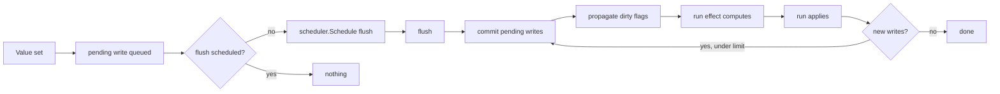

# 0001 — Reactive core

- Status: approved by the maintainer (2026-11-25)
- Date: 2026-11-25
- Scope: `src/Metanui.Reactive` (Phase 1 of `docs/handoff.md`)

## 1. Intent

Metanui needs one reactive programming model that runs unchanged on .NET (Avalonia) and on the web (DOM). The core is written once in C#. On .NET it runs natively; on the web it is transpiled to TypeScript by Metano. This has two consequences:

- the hot path of the web runtime is Metano output, so the core doubles as a benchmark of Metano's codegen;
- the semantics must be precise enough that the SolidJS runtime can replace our core on the web (plan B in the handoff) without the DSL noticing.

## 2. Goals, non-goals, anti-goals

**Goals**

- Fine-grained reactivity: `Signal`, `Computed`, split `Effect`, ownership with cleanup, `Untrack`, explicit `Flush`.
- Public semantics equal to **Solid 2.0** for every primitive we ship (section 4).
- Glitch-free, push-pull propagation with no allocation per read and no closure per read.
- One test suite, executed on .NET and on the transpiled TypeScript.
- Overhead budget: ≤10–15% vs Solid 2.0, measured separately for the core (js-reactivity-benchmark) and for the DOM (js-framework-benchmark).

**Non-goals for Phase 1** (the design must leave room for them, see 5.4)

- Async computeds, `isPending`, `latest`, `<Loading>`-style boundaries.
- Optimistic primitives, actions, transitions.
- Stores, projections, deep proxies.
- Multi-threaded graphs.

**Anti-goals** (a failure even if it works)

- Re-render-and-diff anywhere in the core.
- Hook-order rules or any positional identity.
- Per-read allocation, per-read closure, or per-read virtual dispatch through an interface in the generated TS.
- DOM, Avalonia or any platform API inside `Metanui.Reactive`.
- Working around a Metano emission defect silently: each one becomes a `danfma/metano` issue.

## 3. Approaches

| | Engine | Public semantics | Verdict |
|---|---|---|---|
| A | alien-signals push-pull (doubly linked dependency lists, flag bitfield, no arrays) | alien-signals: writes visible immediately, effects batched | engine kept |
| B | Solid 1.x (source/observer arrays, STALE/PENDING) | Solid 1.x | rejected: more allocation, slower, and Solid 1.x is no longer the baseline |
| C | Solid 2.0 (`@solidjs/signals`) | Solid 2.0: all writes batched on a microtask, split effects, async in the graph | semantics kept |

**Chosen: A + C.** The alien-signals algorithm is the graph engine; the Solid 2.0 semantics are the public contract layered on it. The two are orthogonal: A decides *how* dirtiness propagates, C decides *when* writes become visible and *how* effects run. Rationale:

1. alien-signals is the fastest known algorithm in js-reactivity-benchmark and is made of classes, fields and `while` loops — the shapes Metano emits best.
2. Matching Solid 2.0 makes plan B a drop-in replacement and makes the DOM benchmark an apples-to-apples comparison.
3. Split effects fit retained-mode renderers: tracked compute anywhere, untracked apply on the UI thread.

Maintainer decision: writes follow Solid 2.0 to the letter — a read after a write returns the **old** value until the flush (option (a) of the kickoff discussion).

## 4. Semantics

Citations refer to the Solid 2.0 migration guide and cheatsheet (`solidjs/solid`, `documentation/solid-2.0/MIGRATION.md`, `packages/solid/CHEATSHEET.md`). The contract is pinned to **`@solidjs/signals` 2.0.4** (latest on npm on 2026-11-25; builder's call). Where this document and that version disagree, Solid wins and this document is a bug. Moving the pin is a deliberate change that updates the shared tests and the benchmark baseline together.

### 4.1 Signal

- `Signal<T>` holds a committed value.
- `Value` get: returns the committed value and, inside a tracking scope, subscribes the current observer.
- `Value` set: queues a pending write and schedules a flush. The committed value does not change until the flush (Solid 2.0: "setters don't immediately change what reads return").
- Several writes to the same signal before a flush: the last one wins; the intermediate ones are never observed.
- Equality cut-off: if the pending value equals the committed one, nothing propagates. The default comparison is value equality (`Equals`, so records compare by value); a custom comparer can be passed, and a comparer that never reports equality gives an "always notify" signal.
- `Peek()` (name left to the builder): untracked read of the committed value.

### 4.2 Computed

- `Computed<T>` derives a value from a function. It is lazy (computed on first read), cached, and recomputed only when a dependency actually changed (push dirty flags, pull values).
- Glitch-free: during a flush no observer ever sees a mix of old and new values.
- Same equality cut-off as signals: a recomputation that yields an equal value does not dirty downstream observers.
- Ownership follows Solid's `createMemo`: a `Computed` attaches to the current owner when constructed and is disposed with it (unlinked from its dependencies; a later read returns the last value without recomputing). A `Computed` created outside any owner stays linked from its sources' subscriber lists until it loses its last subscriber (alien-signals/Vue behaviour), so it lives as long as its sources unless it is disposed; create computeds under an owner to bound their lifetime. Signals are plain values and have no owner.
- Dependencies are re-collected on every run (dynamic dependencies); links no longer read are removed.
- An exception thrown by the function is cached as the node's state and rethrown to every reader until a dependency changes (Solid 2.0 propagates errors through the graph).
- Writing a signal inside a computed function is an error. The builder verifies the exact Solid 2.0 behaviour (throw vs dev warning) and matches it. Solid 2.0.4 throws (`REACTIVE_WRITE_IN_OWNED_SCOPE`) whenever the current owner is set, including inside `untrack`; Metanui throws `InvalidOperationException` when the current owner is a computation (computed or effect compute, untracked or not). Writes in an effect's apply and directly in a `Root` body are allowed; the latter is a deliberate deviation (Solid rejects it).

### 4.3 Effect (split)

- `Effect(compute, apply)`: `compute` is tracked and returns a value; `apply(value, previous)` is untracked and performs the side effect. `apply` may return a cleanup that runs before the next `apply` and on disposal.
- `compute` runs during the flush, together with all other computations; every `apply` of the flush runs after **all** computes of that flush. This ordering is what lets renderers read the whole graph before touching the platform.
- On creation, `compute` runs immediately; the first `apply` runs at the end of the current flush (or the next one if created outside a flush).
- Writes performed inside `apply` schedule another flush pass. A pass limit detects infinite update loops and throws.

### 4.4 Errors in effects

- An exception in `compute` or `apply` goes to the nearest error handler on the owner chain (Solid 2.0 error boundaries). Phase 1 ships only the owner-level handler that the DOM renderer needs, not a UI boundary component.
- With no handler, the exception escapes `Flush()` (or the scheduler callback) after the remaining effects of the pass have run, so one failing effect does not freeze the others. The builder confirms the exact Solid 2.0 ordering and matches it.

### 4.5 Ownership and cleanup

- Every computation is created under the current **owner**. `Root(dispose => ...)` creates an owner and hands back its disposer. As in Solid 2.0.4, a root created under an owner is owned by it and disposed with it; the disposer tears it down earlier. A root body is untracked.
- When a computation re-runs, everything it created during the previous run (child computations, cleanups) is disposed first.
- Disposal is depth-first; cleanups of one owner run in reverse registration order.
- `OnCleanup(action)` registers a cleanup on the current owner.
- `OnSettled` (Solid 2.0 replacement for `onMount`) is in scope only if the DOM renderer needs it in Phase 1; the builder decides.

### 4.6 Untrack and flush

- `Untrack(fn)` runs `fn` with no current observer; reads inside it do not subscribe.
- `Flush()` applies pending writes and runs the flush synchronously. Used by tests and by code that must observe its own writes.
- There is no `Batch`: every write is batched (Solid 2.0 removed `batch`).

### 4.7 Scheduling



- The scheduler is a port: `IFlushScheduler` (name left to the builder) with one operation, "run this flush soon".
- Web adapter: `queueMicrotask`.
- .NET adapters: a `SynchronizationContext`/Avalonia `Dispatcher` post (Phase 2), and a manual scheduler for tests where only `Flush()` drives the graph.
- There is one graph per process, held in static fields (section 5.3). It is single-threaded: all reads, writes and flushes happen on the thread that owns the graph. On .NET the core test suite therefore runs serially (TUnit `[NotInParallel]`); Avalonia drives all windows from one UI thread, so one graph suffices (builder's call; revisit only if a multi-UI-thread host appears). Cross-thread writes must go through the scheduler. Enforcing this on .NET (debug-only affinity check) is left to the builder; it must not appear in the TS output.

## 5. Engine

### 5.1 Algorithm

Port of alien-signals (`stackblitz/alien-signals`, the reactivity engine of Vue 3.6): reactive nodes carry a flag bitfield (`Mutable`, `Watching`, `RecursedCheck`, `Recursed`, `Dirty`, `Pending`) and dependency links form two intrusive doubly linked lists per edge (`prevDep/nextDep` on the subscriber side, `prevSub/nextSub` on the dependency side). Core routines: `link`, `unlink`, `propagate`, `checkDirty`, `shallowPropagate`. The builder ports the version current at implementation time and records the upstream commit in the source.

### 5.2 Mapping Solid 2.0 semantics onto the engine

- Pending writes: a per-signal pending slot plus a queue of signals with pending writes; `propagate` starts only at flush time, from the committed signals.
- Split effects: effect nodes are queued by `propagate`; the flush runs every queued compute, collects the resulting applies, then runs them.
- Ownership: an owner tree separate from the dependency graph (parent pointer, first-child/next-sibling, cleanup list), so dependency links stay as lean as in alien-signals.

### 5.3 Hot-path rules (C# that Metano must emit well)

- A read is a method call on the node plus field accesses: no lambda, no interface dispatch, no allocation.
- Nodes and links are `sealed` classes with fields; no `List<T>` in the graph (it maps to the runtime List class, not a native array).
- Global tracking state (current observer, current owner, flush state) lives in static fields of one internal class.
- Flags are a `[Flags] enum` over `int`; Metano must emit them as plain numbers with bitwise ops.
- Avoid the patterns the handoff lists as still allocating closures (switch expressions in field initializers, `?? throw` outside switches).
- Every primitive's generated TS is inspected as part of done; any avoidable overhead is a Metano issue.
- When Metano emits wrong or slow code, work does not stop: open the `danfma/metano` issue and apply a visible workaround with a `// Metano #<issue>` comment, removed once the fix ships. Only a defect with no workaround blocks.

### 5.4 Room for async (not built in Phase 1)

Reserve flag bits for a pending-async state and an error state, and keep the "value or exception" slot on computed nodes, so that async computeds, `isPending` and `latest` can be added later without changing the link structure.

## 6. C# API

```csharp
var count = new Signal<int>(0);
var doubled = new Computed<int>(() => count.Value * 2);

Reactivity.Root(dispose =>
{
    Reactivity.Effect(
        () => doubled.Value,
        (value, previous) => Console.WriteLine($"{previous} -> {value}"));
});

count.Value = 5;      // queued; count.Value still reads 0
Reactivity.Flush();   // count = 5, doubled = 10, apply prints "0 -> 10"
```

- `Signal<T>` and `Computed<T>` are classes with a `Value` property. Metano must emit `Value` as a TS `get value()` (and `set value()` on signals) that calls straight into the engine.
- Free functions live in a static class (`Reactivity` is a placeholder name: the namespace is already `Metanui.Reactive`).
- A lambda is allocated once per computation **creation**, never per read or per run.

### 6.1 Implicit conversion and combining operators — decided

The maintainer asked to keep `.Value` and add `implicit operator T(Signal<T>)` plus operators that combine signals. A spike against Metano 3.0.2 (scratch project, not committed) found:

1. `a == b` with two signals compiles to **reference equality**, silently, even with the implicit conversion to `int` in place (verified on .NET and in the TS output: `a === b`).
2. `$"{count}"` calls `Signal.ToString()`, not the conversion; interpolation never reads the value.
3. The implicit conversion to `T` wins over combining operators: with an extension `operator +` on `Signal<T>`, `a + b` still binds to `int + int` via the conversion and yields an `int`, not a signal.
4. Without the conversion, Metano 3.0.2 emits the C# 14 extension operator as a raw `(a + b).value` in TS (object concatenation) and does not emit the extension class at all — a Metano defect, to be reported.
5. In the DSL, an implicit conversion to `T` turns a reactive binding into a one-shot read with no visible `.Value`: `Text(count)` against a `Text(string)` overload reads once. This is exactly the handoff's open question 1, made invisible.
6. Metano emits the conversion as a static call (`Sig.__implicitToT(a)`), so the cost is fine; the problem is semantics, not speed.

Decision (maintainer, 2026-11-25): the core ships **no `implicit operator T`** and **no combining operators**; `.Value` stays explicit. How the DSL binds reactive values to element properties is out of scope here and moves to `docs/design/0002-dsl-binding.md`, which compares with prototypes and measurements:

1. a single `Prop<T>` input type (implicit from `T` and from `Signal<T>`/`Computed<T>`), with the element API generated from WebIDL/webref and Avalonia metadata — note that a lambda does not convert to `Prop<T>` (CS1660, verified), so derived values need a `Computed`, a `Func<T>` overload or option 3;
2. per-component invalidation, where bindings mark their component dirty and the component copies signal values into the platform elements on update; signals passed as props to custom components are read, and therefore bound, in the child;
3. a Metano/Roslyn lazy-argument feature that emits an argument as `() => expr` (handoff open question 1).

Combining operators are revisited only with a measured need (each operator allocates a computed node), and after re-checking Metano's emission of C# 14 extension operators, which both 3.0.2 and 3.1.0 get wrong (repro sent to the Metano session).

## 7. Testing

- The same scenarios run on .NET (TUnit) and on the generated TS (`bun test`). The preferred shape is scenarios written once in C# against a tiny assertion port, transpiled with the core, and driven by a thin TUnit adapter and a thin Bun adapter. The builder confirms this works with Metano before committing to it; the fallback is two suites kept in lockstep by scenario name.
- Tests use the manual scheduler and `Flush()`; one test per platform exercises the real microtask/dispatcher scheduler.
- Behavioural reference: where practical, port scenarios from the Solid 2.0 and alien-signals test suites.

## 8. Benchmarks

- Core: js-reactivity-benchmark, Metanui (transpiled) vs `@solidjs/signals` 2.x and alien-signals. This is the direct measurement of Metano's codegen.
- DOM: js-framework-benchmark vs hand-written Solid 2.0, React, Svelte and Inferno; time, memory, bundle size. Expect the renderer strategy (template cloning vs element-by-element creation) to dominate here; that belongs to the DSL/renderer design, not to this document.

## 9. Definition of done for this design

- The core and its shared tests pass on .NET and on the transpiled TS.
- The js-reactivity-benchmark adapter runs, and the overhead against `@solidjs/signals` is measured and reported. Missing the 10–15% budget is reported with its causes (Metano issues filed); it does not block this design. The DSL, DOM renderer and js-framework-benchmark come in their own designs.

## 10. Toolchain

- Metano **3.1.0**: `Metano` and `Metano.Build.TypeScript` (the renamed `Metano.Build`) float on NuGet. Closed hierarchies transpile to TS unions with a `kind` getter, switch/throw expressions no longer allocate closures, `[ObjectArgs]` works on primary constructors. C# 15 `union` declarations are still not supported (MS0038), so web-targeted code avoids them.
- The `Metano.Compiler.TypeScript` tool is pinned at 3.1.0 in `dotnet-tools.json`; the generated package peers on `metano-runtime ^3.1.0`.

## 11. Left to the builder

- Exact names: `Peek`, the static class, the scheduler port.
- Whether `OnSettled` ships in Phase 1.
- The debug-only thread affinity check on .NET.
- The shared-scenario test mechanism (section 7), or its fallback.
- The alien-signals revision to port.
