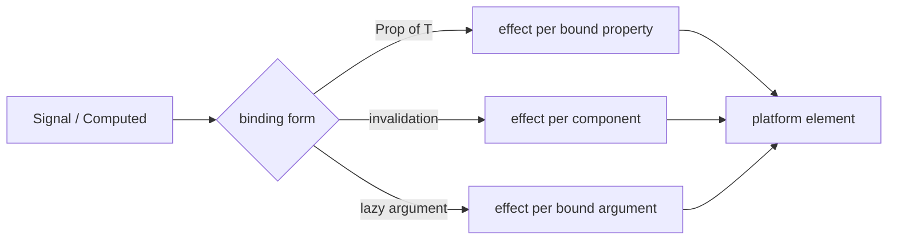

# 0002 - DSL binding

## Status

Stub, 2026-11-25. This is not a design. It records the decisions taken so far and the questions the design must answer. Options are compared with prototypes and measurements, not in this document.

## Decisions taken

### The root as an object

`Reactivity.CreateRoot()` returns an `IDisposable` scope with `Run<T>(Func<T>)`, which can be re-entered. This covers owner capture (Solid `getOwner`/`runWithOwner`) for event handlers and async continuations. The callback `Root` stays as the low-level form.

- **Public type.** The scope is a public `RootScope` (working name). `RootNode` stays internal: the scope exposes only `Run` and `Dispose`, not the node's members.
- **`IDisposable` on the web.** Metano 3.3.0 maps `IDisposable` (#800); `Reactivity.Effect` already returns one. `IAsyncDisposable` is still MS0001, which matches the decision to keep the scope synchronous.
- **The callback `Root` overloads.** The MS0063 `NoWarn` is gone (#799): the void overload is pinned as `rootVoid` in TS. Whether `CreateRoot` replaces the overloads is still open.
- **Re-entrant `Run` rules are open.** See "Re-entrant `Run`" below.

### Users rarely see roots

- `Render(App, container)` creates the app root.
- `For` creates one root per item, and `Show` one per branch.
- Components run under the current owner and are not roots.
- Roots that users create are for long-lived state outside the UI.

### Disposal stays synchronous

Disposal is `IDisposable`, not `IAsyncDisposable`, matching Solid 2. Async support (async computeds, `isPending`, possibly async cleanups) belongs to the async phase. Spec 5.4 reserves the flag bits for it.

Metano agrees with this direction: `IAsyncDisposable` gives MS0001 in 3.x.

### No implicit conversion, no combining operators

The core ships no `implicit operator T` and no combining operators. `.Value` stays explicit (spec 6.1).

## Open questions

- **Context.** Should context be resolved through the owner chain, as in Solid? What is the lookup cost on the hot path, and how does it cross a `For` item root?
- **Read abstraction.** Is there a common read abstraction over `Signal<T>` and `Computed<T>`? Interface dispatch is banned on hot paths (spec 5.3). A shared generic base class does not fit: the node hierarchy (`ReactiveNode`, `SignalNode`, `OwnerNode`, `ComputedNode`) is non-generic on purpose, because the flush queues and the graph walks work on it, and `Signal<T>` already derives from `SignalNode` while `Computed<T>` derives from `ComputedNode`. A common generic base would make that hierarchy generic. The real options, to measure on Bun and V8:
  1. a generic constraint (`TSource : IReadable<T>`). .NET specialises generic code only for value-type arguments, so with the node classes the call is still an interface dispatch; TS has no specialisation at all. Measure before relying on it;
  2. a wrapper struct over either node, with a type test or a stored delegate per read;
  3. a virtual `Value` on a non-generic base. The base cannot name `T`, so the read returns `object` (boxing for value types on .NET) or is a generic virtual method, and costs a virtual call per read.
- **Context per owner.** If context is resolved through the owner chain, where does it live? A field on `OwnerNode` adds a slot to every computed, effect and root, which costs creation time on V8 (handoff F2, node layout). A side table or a context node that only some owners carry must be compared on `createComputations`.
- **Derived values.** A lambda does not convert to `Prop<T>` (CS1660). What is the cheapest way to write `Text(() => $"Count {count.Value}")` or its equivalent?
- **Props to custom components.** A signal passed to a child is read, and therefore bound, in the child. Is that acceptable, or must the parent bind?
- **Element API.** Generated from WebIDL/webref and Avalonia metadata, or hand-written per platform?
- **Analyzers.** How are reactive reads outside a tracking scope, and missing keys in `For`, reported?
- **Effect handle.** Once `Effect` returns an `IDisposable` (Metano 3.3.0), does the DSL use it, or does it rely on owners only?

### Re-entrant `Run`

Each rule needs a scenario before `CreateRoot` lands. The target scenario is named after each question.

- **Signal writes.** A root created under a computation is `UnderComputation`, and a write in its body throws (spec 4.2). A scope created during a component's setup, inside an effect compute, would therefore reject every write its event handlers make through `Run`. Solid 2.0.4 rejects a write whenever the current owner is set and is not a leaf scope (`setSignal` checks `context`, `CONFIG_CHILDREN_FORBIDDEN` and `disposalDepth`); `runWithOwner` only swaps `context`, so a write inside it throws too. That check exists only in the dev build: the prod build has no guard. Options: `Run` keeps the rule (handlers write outside `Run`), or the rule is evaluated against the creation context and not the scope's ancestry. Target scenario: `WriteInsideRunOfScopeCreatedUnderComputation`.
- **`ActiveApply`.** `Run` called from an effect's apply: does it clear `ActiveApply`, so `OnCleanup` registers on the scope and not on the apply? Target scenario: `RunFromApplyRegistersCleanupOnScope`.
- **Disposed scope.** `Run` on a disposed scope: throw, run with no owner, or run and leak (Solid 2.0.4 runs and reports `RUN_WITH_DISPOSED_OWNER`, a warning). Target scenario: `RunOnDisposedScope`.
- **Children per `Run`.** Each `Run` attaches what it creates to the scope, and nothing disposes it before the scope itself. A handler that creates a computed on every click accumulates them. Decide whether `Run` disposes the previous run's children, or document the leak. Target scenario: `RepeatedRunAccumulatesChildren`.
- **Errors outside a flush.** An exception thrown by `Run`'s body outside a flush: does it go to the nearest error boundary above the scope, or escape `Run`? Target scenario: `RunErrorOutsideFlushReachesBoundary`.

## Layering

- **Renderer port.** The DSL talks to a renderer port with a small set of operations: create element, set property, bind event, insert and remove child. The DOM and Avalonia renderers are adapters of that port. The core knows nothing of either.
- **Public core API only.** The DSL and the renderers are separate packages, and Metano emits no `InternalsVisibleTo` across TS packages (#770: internal types are not exported from barrels). They can use only the public core API, so whatever they need, owner capture included, must be public.

## Options to compare

From spec 6.1:

1. **`Prop<T>`.** A single input type, implicit from `T` and from `Signal<T>`/`Computed<T>`. Cost to measure: an allocation per binding if `Prop<T>` is a class, or its size if it is a struct.
2. **Per-component invalidation.** Bindings mark their component dirty, and the component copies signal values into the platform elements on update. Signals passed as props are read, and bound, in the child.
3. **Metano lazy arguments.** A parameter attribute that emits an argument as `() => expr`. It needs a Metano feature request, and it must stay framework-agnostic.

Criteria for the comparison:

- allocations per binding and per update;
- readability of the C# DSL;
- what Metano emits for each form (closures in hot paths are a Metano issue);
- the js-framework-benchmark operations.

## Inputs

- Spec: [0001-reactive-core.md](0001-reactive-core.md), especially 5.3 (hot path), 5.4 (async room) and 6.1 (binding options).
- Metano audit: [0001-reactive-core-ts-audit.md](0001-reactive-core-ts-audit.md).
- Handoff: [../handoff.md](../handoff.md), for the Metano state and the next steps.
- Plan: [../../plans/metano-3.2-effect-handle.md](../../plans/metano-3.2-effect-handle.md), Task 4.
