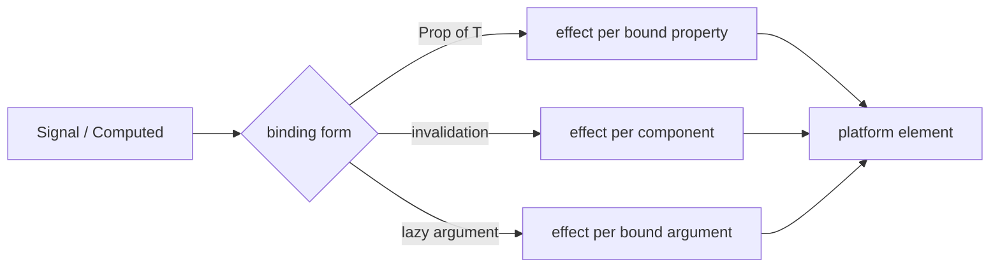

# 0002 - DSL binding

## Status

Proposed v1 design, 2026-11-26, awaiting the maintainer's approval (section "Proposed design (v1)"). The rest of the document is the earlier stub: decisions taken, open questions, and the two spikes the proposal argues from.

## Proposed design (v1)

Scope: the platform-neutral DSL core, the web renderer and HTML vocabulary, and enough control flow to build the js-framework-benchmark app later. The shapes below come from the two spikes at the end of this document.

### Model

- **Fine-grained, setup runs once.** A component's body (or `Render`) runs once under the current owner. Only the parts given as functions bind an effect, which writes one platform property or text node. There is no virtual tree, no diffing and no re-render.
- **Not a React model.** A virtual DOM runtime (Preact, Inferno) would cover only the web, Avalonia would need its own reconciler (as Microsoft UI Reactor wrote one for WinUI), every update would rebuild element descriptors in transpiled C#, and the reactive core would be reduced to a state container.

### Layers and packages

| Layer | Package | Knows |
|---|---|---|
| Reactive core | `Metanui.Reactive` (exists) | nothing of UI |
| DSL core | `Metanui.Ui` | the core and the renderer port; no platform type |
| Renderer port | `Metanui.Ui` (`IRenderer`) | structural operations only |
| Platform | `Metanui.Web` (v1), `Metanui.Avalonia` (later) | the port and its platform: DOM adapter, element and attribute vocabulary, scheduler |

- **The port is structural.** `IRenderer`: `CreateElement(string tag)`, `CreateText(string text)`, `SetText(object text, string value)`, `Insert(object parent, object child, object? anchor)`, `Remove(object parent, object child)`. Nodes are `object` handles: the DSL core never inspects them, so it stays non-generic (no `Part<TNode>` in user code), and a cast in a platform part costs nothing in TS.
- **Attributes and events belong to the platform vocabulary.** A web attribute part knows it writes an `HTMLElement` (`Class`, `Id`, `Style`, `OnClick`, `On(eventName, ...)`, `Value`, `Checked`); an Avalonia vocabulary will write `AvaloniaProperty` values. The port does not carry string-named properties, so no platform pays a lookup per write.
- **Proof of neutrality.** A `TestRenderer` in the scenarios project implements the port by building a printable tree, so the DSL scenarios run unchanged on .NET (TUnit) and on Bun, as the core scenarios do. A minimal Avalonia adapter is a later phase, not v1.

### Authoring shape

- **Hyperscript-like functions (spike option C).** `Div(Class("card"), H1(Text(() => $"Count: {count.Value}")), Button(OnClick(() => count.Value++), "+1"))`, imported with `using static`. Attributes come first and children follow, in HTML order. A string is a static text child.
- **Static or reactive by overload.** Every attribute and `Text` has a `T` and a `Func<T>` overload. A lambda cannot become a `Prop<T>` (CS1660), so there is no `Prop<T>` type.
- **Not in v1:** fluent modifiers (option E) for element-specific escape hatches, grouped `Bind` (option F) as an optimisation, and collection initializers (option D). Metano 4.0.2 removed the per-initializer IIFE (#804), so D is no longer blocked by its emission; it stays out of v1 to keep one authoring shape, and remains open as an alternative to C.

### Components

- **Function components:** a static method returning `Part`.
- **Class components:** `sealed class Badge(Func<string> size) : Component { public override Part Render() => ... }`. The constructor takes the props, `Render` runs once. No records: Metano gives them value semantics that a fine-grained renderer never uses.
- **Reactive props are `Func<T>`.** A parent passes `() => count.Value`. A common read abstraction over `Signal<T>` and `Computed<T>` stays an open question (below), to measure before adding.

### Control flow and mounting

- `Show(Func<bool> when, Func<Part> then, Func<Part>? otherwise = null)`: one root per branch, disposed when the branch changes.
- `For<T>(Func<IReadOnlyList<T>> items, Func<T, Part> render)`: keyed by item reference, one root per item, moves nodes instead of recreating them (Solid `mapArray` semantics, the minimal-move algorithm to choose in the plan).
- `Ui.Render(Func<Part> app, object container, IRenderer renderer)` creates the app root and returns an `IDisposable`.
- The web package ships the microtask `IFlushScheduler`.

### Testing and packaging

- DSL scenarios in C# against `TestRenderer`, run on both runtimes; a web sample (counter, todo list) checked in a browser.
- The web host bundles with the `bun` condition until generated packages build `dist` (spike finding).

### Out of v1

Context, the `CreateRoot` scope and its re-entrant `Run` rules, analyzers, generated element API (WebIDL/webref), Avalonia, the read abstraction, and js-framework-benchmark.

## Decisions taken

### The root as an object

`Reactivity.CreateRoot()` returns an `IDisposable` scope with `Run<T>(Func<T>)`, which can be re-entered. This covers owner capture (Solid `getOwner`/`runWithOwner`) for event handlers and async continuations. The callback `Root` stays as the low-level form.

- **Public type.** The scope is a public `RootScope` (working name). `RootNode` stays internal: the scope exposes only `Run` and `Dispose`, not the node's members.
- **`IDisposable` on the web.** Metano maps `IDisposable` since 3.3.0 (#800) and emits native `using` with `[Symbol.dispose]()` since 4.0.0; `Reactivity.Effect` already returns one. `IAsyncDisposable` is still MS0001, which matches the decision to keep the scope synchronous.
- **The callback `Root` overloads.** The MS0063 `NoWarn` is gone (#799): the void overload is pinned as `rootVoid` in TS. Whether `CreateRoot` replaces the overloads is still open.
- **Re-entrant `Run` rules are open.** See "Re-entrant `Run`" below.

### Users rarely see roots

- `Render(App, container)` creates the app root.
- `For` creates one root per item, and `Show` one per branch.
- Components run under the current owner and are not roots.
- Roots that users create are for long-lived state outside the UI.

### Disposal stays synchronous

Disposal is `IDisposable`, not `IAsyncDisposable`, matching Solid 2. Async support (async computeds, `isPending`, possibly async cleanups) belongs to the async phase. Spec 5.4 reserves the flag bits for it.

Metano agrees with this direction: `IAsyncDisposable` gives MS0001 in 3.x.

### No implicit conversion, no combining operators

The core ships no `implicit operator T` and no combining operators. `.Value` stays explicit (spec 6.1).

## Open questions

- **Context.** Should context be resolved through the owner chain, as in Solid? What is the lookup cost on the hot path, and how does it cross a `For` item root?
- **Read abstraction.** Is there a common read abstraction over `Signal<T>` and `Computed<T>`? Interface dispatch is banned on hot paths (spec 5.3). A shared generic base class does not fit: the node hierarchy (`ReactiveNode`, `SignalNode`, `OwnerNode`, `ComputedNode`) is non-generic on purpose, because the flush queues and the graph walks work on it, and `Signal<T>` already derives from `SignalNode` while `Computed<T>` derives from `ComputedNode`. A common generic base would make that hierarchy generic. The real options, to measure on Bun and V8:
  1. a generic constraint (`TSource : IReadable<T>`). .NET specialises generic code only for value-type arguments, so with the node classes the call is still an interface dispatch; TS has no specialisation at all. Measure before relying on it;
  2. a wrapper struct over either node, with a type test or a stored delegate per read;
  3. a virtual `Value` on a non-generic base. The base cannot name `T`, so the read returns `object` (boxing for value types on .NET) or is a generic virtual method, and costs a virtual call per read.
- **Context per owner.** If context is resolved through the owner chain, where does it live? A field on `OwnerNode` adds a slot to every computed, effect and root, which costs creation time on V8 (handoff F2, node layout). A side table or a context node that only some owners carry must be compared on `createComputations`.
- **Derived values.** A lambda does not convert to `Prop<T>` (CS1660). What is the cheapest way to write `Text(() => $"Count {count.Value}")` or its equivalent?
- **Props to custom components.** A signal passed to a child is read, and therefore bound, in the child. Is that acceptable, or must the parent bind?
- **Element API.** Generated from WebIDL/webref and Avalonia metadata, or hand-written per platform?
- **Analyzers.** How are reactive reads outside a tracking scope, and missing keys in `For`, reported?
- **Effect handle.** `Effect` returns an `IDisposable` (since Metano 3.3.0); does the DSL use it, or does it rely on owners only?

### Re-entrant `Run`

Each rule needs a scenario before `CreateRoot` lands. The target scenario is named after each question.

- **Signal writes.** A root created under a computation is `UnderComputation`, and a write in its body throws (spec 4.2). A scope created during a component's setup, inside an effect compute, would therefore reject every write its event handlers make through `Run`. Solid 2.0.4 rejects a write whenever the current owner is set and is not a leaf scope (`setSignal` checks `context`, `CONFIG_CHILDREN_FORBIDDEN` and `disposalDepth`); `runWithOwner` only swaps `context`, so a write inside it throws too. That check exists only in the dev build: the prod build has no guard. Options: `Run` keeps the rule (handlers write outside `Run`), or the rule is evaluated against the creation context and not the scope's ancestry. Target scenario: `WriteInsideRunOfScopeCreatedUnderComputation`.
- **`ActiveApply`.** `Run` called from an effect's apply: does it clear `ActiveApply`, so `OnCleanup` registers on the scope and not on the apply? Target scenario: `RunFromApplyRegistersCleanupOnScope`.
- **Disposed scope.** `Run` on a disposed scope: throw, run with no owner, or run and leak (Solid 2.0.4 runs and reports `RUN_WITH_DISPOSED_OWNER`, a warning). Target scenario: `RunOnDisposedScope`.
- **Children per `Run`.** Each `Run` attaches what it creates to the scope, and nothing disposes it before the scope itself. A handler that creates a computed on every click accumulates them. Decide whether `Run` disposes the previous run's children, or document the leak. Target scenario: `RepeatedRunAccumulatesChildren`.
- **Errors outside a flush.** An exception thrown by `Run`'s body outside a flush: does it go to the nearest error boundary above the scope, or escape `Run`? Target scenario: `RunErrorOutsideFlushReachesBoundary`.

## Layering

- **Renderer port.** The DSL talks to a renderer port with a small set of operations: create element, set property, bind event, insert and remove child. The DOM and Avalonia renderers are adapters of that port. The core knows nothing of either.
- **Public core API only.** The DSL and the renderers are separate packages, and Metano emits no `InternalsVisibleTo` across TS packages (#770: internal types are not exported from barrels). They can use only the public core API, so whatever they need, owner capture included, must be public.

## Options to compare

From spec 6.1:

1. **`Prop<T>`.** A single input type, implicit from `T` and from `Signal<T>`/`Computed<T>`. Cost to measure: an allocation per binding if `Prop<T>` is a class, or its size if it is a struct.
2. **Per-component invalidation.** Bindings mark their component dirty, and the component copies signal values into the platform elements on update. Signals passed as props are read, and bound, in the child.
3. **Metano lazy arguments.** A parameter attribute that emits an argument as `() => expr`. It needs a Metano feature request, and it must stay framework-agnostic.



Criteria for the comparison:

- allocations per binding and per update;
- readability of the C# DSL;
- what Metano emits for each form (closures in hot paths are a Metano issue);
- the js-framework-benchmark operations.

## Spike: counter (2026-11-26)

Throwaway prototype on branch `spike/dsl-counter`: `spikes/Metanui.Spike.Counter` (C#, transpiled by Metano 4.0.0) and `spikes/counter-web` (Bun host). A counter with a derived value, written as:

```csharp
var count = Reactivity.Signal(0);
var doubled = Reactivity.Computed(() => count.Value * 2);

return Html.Element(
    "div",
    Html.Element("h1", Html.Text(() => $"Count: {count.Value}")),
    Html.Element("p", Html.Text(() => $"Doubled: {doubled.Value}")),
    Html.Button("-1", () => count.Value--),
    Html.Button("+1", () => count.Value++)
);
```

`Html` creates each DOM node once; only the parts passed as `Func<T>` get an effect that writes the node in the apply phase. Verified in Chrome: renders, `+1` x3 then `-1` gives 3/6 then 2/4, no console error.

What it taught:

- **DOM interop works with `[External]` interfaces** (`Node`, `Text`, `HTMLElement`, `Document`) and an `[External, NoContainer]` static class for the globals (`document`, `queueMicrotask`). The emitted TS uses the lib.dom names directly, with no import and no wrapper; strict tsc with `lib: DOM` is clean. Hand-writing these shapes does not scale (see "Element API" above).
- **Reactive reads as `Func<T>` read well and cost one effect per binding.** An overload pair `Text(string)` / `Text(Func<string>)` becomes the fast paths `textString` / `textFuncOfString`, and call sites bind to them directly, with no dispatcher.
- **`int` arithmetic is emitted with .NET semantics:** `count.Value++` becomes `(count.value + 1) | 0` and `* 2` becomes `Math.imul`. Correct, but a cost on numeric hot paths; the DSL should not push users to `int` math in bindings by accident.
- **`[ModuleEntryPoint]` needs `[NoContainer]`**, and the generated package declares `sideEffects: false`, so a bundler may drop top-level code. The host calls `CounterApp.Main()` explicitly instead.
- **Web packaging gap:** the generated packages export TS sources only under the `bun` condition (`dist` is not built). Bun's HTML dev server bundles for the browser without that condition, so the spike bundles with `bun build --conditions=bun`. A real web target needs a `dist` build or an explicit condition in the app bundler.
- **Size:** the bundle is 31.8 KB minified, 8.2 KB gzipped. Most of it is metano-runtime: ten exception classes, equality, the default comparer, reflection and the disposable helper, pulled in by the reactive core (comparers, `InvalidOperationException`, `IDisposable`). Worth a pass before a js-framework-benchmark comparison.
- **Scheduler:** the web adapter is a three-line `IFlushScheduler` over `queueMicrotask`, in C#. The first apply of a binding needs a flush, so mounting relies on the scheduler; with the manual scheduler nothing would paint.

## Spike: DSL shapes (2026-11-26)

Throwaway prototype `spikes/Metanui.Spike.Dsl` + `spikes/dsl-web`: the same app (counter, reactive class, a `Badge` class component with a reactive prop) in seven shapes, side by side (B, the builder lambda, became G). All of them work in Chrome, except G's form 4b on the web (Metano #828). Reference: Microsoft UI Reactor is a React model (class `Component`/`Component<TProps>` with `Render()`, hooks such as `UseState`, a virtual tree and reconciler), with positional factories (`Button("+", onClick)`, `VStack(8, a, b)`) plus fluent modifiers; its samples show the inversion (`.Padding(...).Grid(row: 0, column: 0)` after a whole child block).

| Shape | Source | Emitted TS | Verdict |
|---|---|---|---|
| A. Props object `P(new Props { Class = Bind(() => …) }, "x")` | A lambda cannot convert implicitly to `Prop<T>` (CS1660, verified), so reactive props need `Bind(...)`; every attribute is a property | On Metano 4.0.1, one IIFE plus `Object.assign` per element; on 4.0.2, comma expressions over hoisted `let` temporaries | Rejected |
| C. Attribute list `P(Class(() => …), "x")` | HTML order; `T`/`Func<T>` overloads pick static or reactive; strings convert to text | Straight calls (`classFuncOfString`), no closure beyond the user's | Lead candidate |
| D. Collection initializer `new P(Class(...)) { "x" }` | Reads like markup, but `new` everywhere and one class per element | On Metano 4.0.1, one IIFE per element; on 4.0.2 (#804), a hoisted `const` plus `add` calls, no closure | Viable since Metano 4.0.2; alternative to C |
| E. Fluent `P("x").WithClass(() => …)` | Typed per element, discoverable; attributes after children (inverted for large trees) | Straight calls | Kept for element-specific escape hatches |
| F. Grouped `Bind(P(), () => [TextContent(...), ClassName(...)])` | Groups several properties under one effect | Each run allocates the array and setters and rewrites every property of the group | Possible optimisation (fewer effect nodes), not the default |
| G. Builder lambda `P(p => { p.TextContent = ...; p.ClassName <<= () => ...; })` | Typed per element, element refs for free, setup code inline; children attach through an ambient scope; attributes and children are statements, so the tree reads less like markup | One closure per element at setup; with `Bindable<T>` properties every static write and every apply of forms 1–2 allocates a wrapper | Viable; the binding forms below need care |

Option G binding forms (maintainer's proposal; C# semantics checked in a standalone probe, then in the spike):

1. `Bind(count, value => p.TextContent = $"...{value}")`: works. Explicit source, so the dependency is declared twice (source and body).
2. `Bind(count, () => p.TextContent = $"...{count.Value}")`: works; the body runs untracked, so a signal read in the body but not declared as the source never updates the element (the dependency-list footgun of React's `useEffect`).
3. `p.ClassName <<= () => ...`: works only through a static `operator <<` plus the property setter (`p.ClassName = p.ClassName << f`). C# 14 instance compound operators are never applied to a property receiver (CS0019 with a setter, CS0200 without one). Needs every property typed `Bindable<T>`, and the right side must be a lambda to be reactive; it is sugar for form 4a.
4. `p.TextContent = Bind($"...{count.Value}")` cannot be reactive: the hole is evaluated before the call, so an interpolated string handler receives the `int`. `Bind(() => $"...")` (4a) works through an implicit `Binding<T>` → `Bindable<T>` conversion. `Bind($"...{count}")` (4b) works on .NET through a custom `[InterpolatedStringHandler]` that keeps signal holes live, but Metano 4.0.2 emits a template literal and passes a string (#828); and `{count}` vs `{count.Value}` silently decides between live and frozen.
5. A fused `Bind(() => p.TextContent = ...)` next to `Bind<T>(Func<T>)` silently binds to the `Func` overload (the assignment has a value), so it returns a reader and binds nothing. The two need different names.

Other findings:

- A base class with an implicit conversion that creates a subclass forms an import cycle (MS0005, a real ESM TDZ hazard); the subclass is nested in the base.
- Class components with constructor props work; a reactive prop is a `Func<T>`. Records were not used for props: Metano gives them .NET value semantics, which a fine-grained renderer never uses.
- Metano 4.0.2 (#804) shrank the whole gallery bundle from 55,503 to 51,618 bytes minified (13,000 to 12,713 gzipped), all of it from options A and D; the other variants emit the same code.
- Strict `tsc` over the spike output fails on two Metano defects that 4.0.1 already had: a cross-project reference to an `[External]` interface emits `import type` from a subpath the referenced package does not export (#826), and `$runtimeType` assigns a class with a private constructor to `ClassType<T>`'s public `ctor` (#827). Bun erases the type import, so the bundle works.
- The spike's `Part.AttachTo(HTMLElement)` is DOM-bound. The real layering puts a platform-neutral renderer port under the DSL (see "Layering").

## Inputs

- Spec: [0001-reactive-core.md](0001-reactive-core.md), especially 5.3 (hot path), 5.4 (async room) and 6.1 (binding options).
- Metano audit: [0001-reactive-core-ts-audit.md](0001-reactive-core-ts-audit.md).
- Handoff: [../handoff.md](../handoff.md), for the Metano state and the next steps.
- Plan: [../../plans/metano-3.2-effect-handle.md](../../plans/metano-3.2-effect-handle.md), Task 4.
