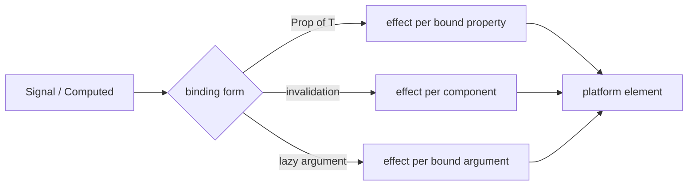

# 0002 - DSL binding

## Status

Accepted, 2026-11-27: option H (section "Design (v1)"), chosen after eight shapes were prototyped (spike sections at the end). Implementation plan: [`plans/dsl-v1.md`](../../plans/dsl-v1.md). The sections after "Design (v1)" are the earlier stub (decisions, open questions) and the spike record the design argues from; where they disagree with "Design (v1)", "Design (v1)" wins.

## Design (v1)

Scope: a keyed `Map` in the reactive core, the platform-neutral UI layer, the web adapter with a hand-written subset of the DOM, and a `Counter`/`CounterList` sample.

### Model

- **Fine-grained, setup runs once.** A builder lambda or a component's `Render` runs once under the current owner. A binding is an effect that writes one platform property. There is no virtual tree, no diffing and no re-render.
- **Not a React model.** A virtual DOM runtime (Preact, Inferno) would cover only the web, Avalonia would need its own reconciler (as Microsoft UI Reactor wrote one for WinUI), every update would rebuild element descriptors in transpiled C#, and the reactive core would be reduced to a state container.

### Layers and packages

| Layer | Package | Knows |
|---|---|---|
| Reactive core | `Metanui.Reactive` | nothing of UI; gains `Map` and `Signal<T>.Update` |
| UI core | `Metanui.Ui` | the core and the node port; no platform type |
| Web adapter | `Metanui.Ui.Web` (v1) | `[External]` DOM types, element factories, the DOM port, the microtask scheduler |
| Avalonia adapter | `Metanui.Ui.Avalonia` (later) | native controls |

- **The port is structural and small.** `INodePort`: `CreateText`, `SetText`, `CreateAnchor`, `Insert(parent, node, anchor)`, `Remove(parent, node)`, on `object` handles, so `Metanui.Ui` stays non-generic. Elements are created by the platform factories; the port exists for text, anchors, `For`, `Show` and component content.
- **The vocabulary is the platform's own object model.** On the web, element types are `[External]` interfaces: they give C# types and completion and emit nothing, so a large vocabulary costs no bundle size. On Avalonia, the native controls are the vocabulary. Nothing wraps an element and no property type carries reactivity.
- **Proof of neutrality:** `Metanui.Ui` scenarios run against a fake port on .NET and Bun.

### Authoring shape (option H)

```csharp
Section(section =>
{
    section.ClassName = "card";
    H2(heading => Bind(() => heading.TextContent = $"Count: {count.Value}"));
    Button(button =>
    {
        button.TextContent = "+1";
        button.OnClick(() => count.Update(c => c + 1));
    });
});
```

- A builder lambda receives the typed platform element; a child created inside it attaches to it through an ambient scope. Static values are plain assignments.
- **Fused `Bind(() => target.Prop = expr)`:** the write runs in the tracked compute, at once and on every change. Use it for platform properties. A signal write there throws (spec 0001).
- **Split `Bind(() => expr, value => target.Prop = value)`:** the write runs in the apply phase, and equality skips unchanged values. Use it when the result changes less often than its sources.
- Events are extension methods (`OnClick`, `OnInput`) emitted as module functions.

### Components

- `sealed class Card : Component<Card>` with a `Render()` that runs once; children go in the `Content` render prop.
- **A prop that `Render` binds is a `Prop<T>`** (maintainer decision, 2026-11-27): a `readonly struct` holding a static value or a reader `Func<T>`, with no signal inside. `Value` returns the value or calls the reader, so a read inside a `Bind` in `Render` is tracked.
  - **Static:** an implicit conversion from `T` (`card.Title = "Solo"`); it reaches `Render` at once, with no flush.
  - **Reactive:** `View.Live(() => expr)` (`card.Title = Live(() => $"#{count.Value}")`). A lambda does not convert to a user type (CS1660), so a factory is needed. It is not a `Bind` overload: an assignment lambda has a value, so C# would pick a `Func` overload over the fused `Bind(Action)` and bind nothing. It is not `Prop.Of`: a non-generic `Prop` next to `Prop<T>` is one TS name (Metano MS0070).
  - Assigning a `Prop<T>` writes no signal, so it works in a factory lambda inside a `For` item or a `Show` branch, where a signal-backed prop threw (spec 0001).
  - Emitted TS: the conversion is a static call (`Prop.__implicitFromT("Solo")`), `Live` a static call that builds one `Prop` at setup; a read is `prop.value`, a field test plus the reader call, with no allocation per update. Metano emits `equals`/`hashCode` for any struct, unused here. Metano requires a `Prop<T>` property to be initialized (MS0001), so `default(Prop<T>)` exists only on .NET, where it reads as `default(T)`.
- **A plain property is read-once configuration:** `Render` reads it once, and a later binding to it is lost silently (spike: `Count: 1 (Start = 106)`). Events stay plain delegates (`Action OnRemove`). An analyzer comes later.
- Each component exposes a one-line static factory until Metano #832 lets `Component<TSelf>.Use(...)` construct `TSelf`.

### Control flow and mounting

- `Reactivity.Map(source, map)` and `Map(source, key, map)` in the core: keyed by `EqualityComparer<T>.Default` or a key selector, one owner per item kept across reruns, duplicate keys paired in order (Solid `mapArray` semantics on C# equality).
- `For` over `Map`, between two anchors, moving nodes instead of recreating them.
- `Show(when, then, otherwise)`: one root per branch, disposed when the branch changes.
- `Ui.Render(build, container, port)` returns an `IDisposable`; the web package wraps it with its port and the microtask scheduler.
- Lists are immutable snapshots in a signal (`entries.Value = [.. entries.Value, entry]`), diffed by key. An observable mutable list (`ReactiveList<T>`) is later work and would feed the same `For`.

### Out of v1

Avalonia, WebIDL-generated DOM types, context, analyzers, `ReactiveList<T>`, interpolated-template binding (`Bind($"Count: {count}")`, after Metano #828), the read abstraction over `Signal`/`Computed`, and js-framework-benchmark.

## Decisions taken

### The root as an object

`Reactivity.CreateRoot()` returns an `IDisposable` scope with `Run<T>(Func<T>)`, which can be re-entered. This covers owner capture (Solid `getOwner`/`runWithOwner`) for event handlers and async continuations. The callback `Root` stays as the low-level form.

- **Public type.** The scope is a public `RootScope` (working name). `RootNode` stays internal: the scope exposes only `Run` and `Dispose`, not the node's members.
- **`IDisposable` on the web.** Metano maps `IDisposable` since 3.3.0 (#800) and emits native `using` with `[Symbol.dispose]()` since 4.0.0; `Reactivity.Effect` already returns one. `IAsyncDisposable` is still MS0001, which matches the decision to keep the scope synchronous.
- **The callback `Root` overloads.** The MS0063 `NoWarn` is gone (#799): the void overload is pinned as `rootVoid` in TS. Whether `CreateRoot` replaces the overloads is still open.
- **Re-entrant `Run` rules are open.** See "Re-entrant `Run`" below.

### Users rarely see roots

- `Render(App, container)` creates the app root.
- `For` creates one root per item, and `Show` one per branch.
- Components run under the current owner and are not roots.
- Roots that users create are for long-lived state outside the UI.

### Disposal stays synchronous

Disposal is `IDisposable`, not `IAsyncDisposable`, matching Solid 2. Async support (async computeds, `isPending`, possibly async cleanups) belongs to the async phase. Spec 5.4 reserves the flag bits for it.

Metano agrees with this direction: `IAsyncDisposable` gives MS0001 in 3.x.

### No implicit conversion, no combining operators

The core ships no `implicit operator T` and no combining operators. `.Value` stays explicit (spec 6.1).

## Open questions

- **Context.** Should context be resolved through the owner chain, as in Solid? What is the lookup cost on the hot path, and how does it cross a `For` item root?
- **Read abstraction.** Is there a common read abstraction over `Signal<T>` and `Computed<T>`? Interface dispatch is banned on hot paths (spec 5.3). A shared generic base class does not fit: the node hierarchy (`ReactiveNode`, `SignalNode`, `OwnerNode`, `ComputedNode`) is non-generic on purpose, because the flush queues and the graph walks work on it, and `Signal<T>` already derives from `SignalNode` while `Computed<T>` derives from `ComputedNode`. A common generic base would make that hierarchy generic. The real options, to measure on Bun and V8:
  1. a generic constraint (`TSource : IReadable<T>`). .NET specialises generic code only for value-type arguments, so with the node classes the call is still an interface dispatch; TS has no specialisation at all. Measure before relying on it;
  2. a wrapper struct over either node, with a type test or a stored delegate per read;
  3. a virtual `Value` on a non-generic base. The base cannot name `T`, so the read returns `object` (boxing for value types on .NET) or is a generic virtual method, and costs a virtual call per read.
- **Context per owner.** If context is resolved through the owner chain, where does it live? A field on `OwnerNode` adds a slot to every computed, effect and root, which costs creation time on V8 (handoff F2, node layout). A side table or a context node that only some owners carry must be compared on `createComputations`.
- **Derived values.** A lambda does not convert to `Prop<T>` (CS1660); v1 uses `Live(() => ...)` for props and `Text(() => ...)` for text. Is there a cheaper spelling?
- **Props to custom components.** A signal passed to a child is read, and therefore bound, in the child. Is that acceptable, or must the parent bind?
- **Element API.** Generated from WebIDL/webref and Avalonia metadata, or hand-written per platform?
- **Analyzers.** How are reactive reads outside a tracking scope, and missing keys in `For`, reported?
- **Effect handle.** `Effect` returns an `IDisposable` (since Metano 3.3.0); does the DSL use it, or does it rely on owners only?

### Re-entrant `Run`

Each rule needs a scenario before `CreateRoot` lands. The target scenario is named after each question.

- **Signal writes.** A root created under a computation is `UnderComputation`, and a write in its body throws (spec 4.2). A scope created during a component's setup, inside an effect compute, would therefore reject every write its event handlers make through `Run`. Solid 2.0.4 rejects a write whenever the current owner is set and is not a leaf scope (`setSignal` checks `context`, `CONFIG_CHILDREN_FORBIDDEN` and `disposalDepth`); `runWithOwner` only swaps `context`, so a write inside it throws too. That check exists only in the dev build: the prod build has no guard. Options: `Run` keeps the rule (handlers write outside `Run`), or the rule is evaluated against the creation context and not the scope's ancestry. Target scenario: `WriteInsideRunOfScopeCreatedUnderComputation`.
- **`ActiveApply`.** `Run` called from an effect's apply: does it clear `ActiveApply`, so `OnCleanup` registers on the scope and not on the apply? Target scenario: `RunFromApplyRegistersCleanupOnScope`.
- **Disposed scope.** `Run` on a disposed scope: throw, run with no owner, or run and leak (Solid 2.0.4 runs and reports `RUN_WITH_DISPOSED_OWNER`, a warning). Target scenario: `RunOnDisposedScope`.
- **Children per `Run`.** Each `Run` attaches what it creates to the scope, and nothing disposes it before the scope itself. A handler that creates a computed on every click accumulates them. Decide whether `Run` disposes the previous run's children, or document the leak. Target scenario: `RepeatedRunAccumulatesChildren`.
- **Errors outside a flush.** An exception thrown by `Run`'s body outside a flush: does it go to the nearest error boundary above the scope, or escape `Run`? Target scenario: `RunErrorOutsideFlushReachesBoundary`.

## Layering

- **Renderer port.** The DSL talks to a renderer port with a small set of operations: create element, set property, bind event, insert and remove child. The DOM and Avalonia renderers are adapters of that port. The core knows nothing of either.
- **Public core API only.** The DSL and the renderers are separate packages, and Metano emits no `InternalsVisibleTo` across TS packages (#770: internal types are not exported from barrels). They can use only the public core API, so whatever they need, owner capture included, must be public.

## Options to compare

From spec 6.1:

1. **`Prop<T>`.** A single input type, implicit from `T` and from `Signal<T>`/`Computed<T>`. Cost to measure: an allocation per binding if `Prop<T>` is a class, or its size if it is a struct.
2. **Per-component invalidation.** Bindings mark their component dirty, and the component copies signal values into the platform elements on update. Signals passed as props are read, and bound, in the child.
3. **Metano lazy arguments.** A parameter attribute that emits an argument as `() => expr`. It needs a Metano feature request, and it must stay framework-agnostic.



Criteria for the comparison:

- allocations per binding and per update;
- readability of the C# DSL;
- what Metano emits for each form (closures in hot paths are a Metano issue);
- the js-framework-benchmark operations.

## Spike: counter (2026-11-26)

Throwaway prototype on branch `spike/dsl-counter`: `spikes/Metanui.Spike.Counter` (C#, transpiled by Metano 4.0.0) and `spikes/counter-web` (Bun host). A counter with a derived value, written as:

```csharp
var count = Reactivity.Signal(0);
var doubled = Reactivity.Computed(() => count.Value * 2);

return Html.Element(
    "div",
    Html.Element("h1", Html.Text(() => $"Count: {count.Value}")),
    Html.Element("p", Html.Text(() => $"Doubled: {doubled.Value}")),
    Html.Button("-1", () => count.Value--),
    Html.Button("+1", () => count.Value++)
);
```

`Html` creates each DOM node once; only the parts passed as `Func<T>` get an effect that writes the node in the apply phase. Verified in Chrome: renders, `+1` x3 then `-1` gives 3/6 then 2/4, no console error.

What it taught:

- **DOM interop works with `[External]` interfaces** (`Node`, `Text`, `HTMLElement`, `Document`) and an `[External, NoContainer]` static class for the globals (`document`, `queueMicrotask`). The emitted TS uses the lib.dom names directly, with no import and no wrapper; strict tsc with `lib: DOM` is clean. Hand-writing these shapes does not scale (see "Element API" above).
- **Reactive reads as `Func<T>` read well and cost one effect per binding.** An overload pair `Text(string)` / `Text(Func<string>)` becomes the fast paths `textString` / `textFuncOfString`, and call sites bind to them directly, with no dispatcher.
- **`int` arithmetic is emitted with .NET semantics:** `count.Value++` becomes `(count.value + 1) | 0` and `* 2` becomes `Math.imul`. Correct, but a cost on numeric hot paths; the DSL should not push users to `int` math in bindings by accident.
- **`[ModuleEntryPoint]` needs `[NoContainer]`**, and the generated package declares `sideEffects: false`, so a bundler may drop top-level code. The host calls `CounterApp.Main()` explicitly instead.
- **Web packaging gap:** the generated packages export TS sources only under the `bun` condition (`dist` is not built). Bun's HTML dev server bundles for the browser without that condition, so the spike bundles with `bun build --conditions=bun`. A real web target needs a `dist` build or an explicit condition in the app bundler.
- **Size:** the bundle is 31.8 KB minified, 8.2 KB gzipped. Most of it is metano-runtime: ten exception classes, equality, the default comparer, reflection and the disposable helper, pulled in by the reactive core (comparers, `InvalidOperationException`, `IDisposable`). Worth a pass before a js-framework-benchmark comparison.
- **Scheduler:** the web adapter is a three-line `IFlushScheduler` over `queueMicrotask`, in C#. The first apply of a binding needs a flush, so mounting relies on the scheduler; with the manual scheduler nothing would paint.

## Spike: DSL shapes (2026-11-26)

Throwaway prototype `spikes/Metanui.Spike.Dsl` + `spikes/dsl-web`: the same app (counter, reactive class, a `Badge` class component with a reactive prop) in seven shapes, side by side (B, the builder lambda, became G). All of them work in Chrome, except G's form 4b on the web (Metano #828). Reference: Microsoft UI Reactor is a React model (class `Component`/`Component<TProps>` with `Render()`, hooks such as `UseState`, a virtual tree and reconciler), with positional factories (`Button("+", onClick)`, `VStack(8, a, b)`) plus fluent modifiers; its samples show the inversion (`.Padding(...).Grid(row: 0, column: 0)` after a whole child block).

| Shape | Source | Emitted TS | Verdict |
|---|---|---|---|
| A. Props object `P(new Props { Class = Bind(() => …) }, "x")` | A lambda cannot convert implicitly to `Prop<T>` (CS1660, verified), so reactive props need `Bind(...)`; every attribute is a property | On Metano 4.0.1, one IIFE plus `Object.assign` per element; on 4.0.2, comma expressions over hoisted `let` temporaries | Rejected |
| C. Attribute list `P(Class(() => …), "x")` | HTML order; `T`/`Func<T>` overloads pick static or reactive; strings convert to text | Straight calls (`classFuncOfString`), no closure beyond the user's | Lead candidate |
| D. Collection initializer `new P(Class(...)) { "x" }` | Reads like markup, but `new` everywhere and one class per element | On Metano 4.0.1, one IIFE per element; on 4.0.2 (#804), a hoisted `const` plus `add` calls, no closure | Viable since Metano 4.0.2; alternative to C |
| E. Fluent `P("x").WithClass(() => …)` | Typed per element, discoverable; attributes after children (inverted for large trees) | Straight calls | Kept for element-specific escape hatches |
| F. Grouped `Bind(P(), () => [TextContent(...), ClassName(...)])` | Groups several properties under one effect | Each run allocates the array and setters and rewrites every property of the group | Possible optimisation (fewer effect nodes), not the default |
| G. Builder lambda `P(p => { p.TextContent = ...; p.ClassName <<= () => ...; })` | Typed per element, element refs for free, setup code inline; children attach through an ambient scope; attributes and children are statements, so the tree reads less like markup | One closure per element at setup; with `Bindable<T>` properties every static write and every apply of forms 1–2 allocates a wrapper | Viable; the binding forms below need care |

Option G binding forms (maintainer's proposal; C# semantics checked in a standalone probe, then in the spike):

1. `Bind(count, value => p.TextContent = $"...{value}")`: works. Explicit source, so the dependency is declared twice (source and body).
2. `Bind(count, () => p.TextContent = $"...{count.Value}")`: works; the body runs untracked, so a signal read in the body but not declared as the source never updates the element (the dependency-list footgun of React's `useEffect`).
3. `p.ClassName <<= () => ...`: works only through a static `operator <<` plus the property setter (`p.ClassName = p.ClassName << f`). C# 14 instance compound operators are never applied to a property receiver (CS0019 with a setter, CS0200 without one). Needs every property typed `Bindable<T>`, and the right side must be a lambda to be reactive; it is sugar for form 4a.
4. `p.TextContent = Bind($"...{count.Value}")` cannot be reactive: the hole is evaluated before the call, so an interpolated string handler receives the `int`. `Bind(() => $"...")` (4a) works through an implicit `Binding<T>` → `Bindable<T>` conversion. `Bind($"...{count}")` (4b) works on .NET through a custom `[InterpolatedStringHandler]` that keeps signal holes live, but Metano 4.0.2 emits a template literal and passes a string (#828); and `{count}` vs `{count.Value}` silently decides between live and frozen.
5. A fused `Bind(() => p.TextContent = ...)` next to `Bind<T>(Func<T>)` silently binds to the `Func` overload (the assignment has a value), so it returns a reader and binds nothing. The two need different names.

Custom components, C vs G (the same `Card`: title static or reactive, reactive `Highlighted`, `OnClose`, child content; both work in Chrome):

| | C (`CardC`, constructor props) | G (`CardG`, `Bindable<T>` properties) |
|---|---|---|
| Author code (lines, no blanks or comments) | 15 | 19, plus a one-line factory |
| Consumer code for two cards | 20 | 31 |
| A static prop value | Wrapped: `title: () => "x"` | Plain: `card.Title = "x"` |
| A reactive prop value | `title: () => $"..."` | `card.Title = Bind(() => $"...")` |
| Optional props | Defaults before `params`; skipping one forces named arguments, and the children then need `content: [...]` | Free: unset properties keep their default |
| Adding a prop | A constructor parameter; positional callers break | One property |
| Forwarding a prop to an element | Wrap or call it (`Text(title)`) | Assign it (`heading.TextContent = Title`) |
| Setup allocations | One `AttributePart` and closure per attribute, one array per element | One `Bindable` per static value, one closure and one scope per element |

- Metano 4.0.2 emits a named `params` argument given as an array (`content: [P("x")]`) as one rest element, so the callee receives a nested array (strict tsc TS2345; Metano #829). The spike passes the skipped optional prop positionally instead.
- G's `Mount` collects the children in a detached `div` before `Render` runs, so the content gets a wrapper element; the renderer port's insert-before-anchor removes it.

Option H (maintainer's proposal): builder lambdas over the platform element itself (`[External]` DOM types, so the web emits no wrapper: `section.className = "variant"`), plain properties everywhere, and bindings as effects that write them. Checked in Chrome:

- Three binding forms work on elements: `count.BindTo(value => p.TextContent = ...)` (one explicit source), split `Bind(() => expr, value => p.TextContent = value)` (the write runs in the apply phase of the flush), and fused `Bind(() => p.TextContent = $"...")` (the write runs in the tracked compute, at once and on every change).
- Component props backed by signals (`public string Title { get => _title.Value; set => _title.Value = value; }`) take a static assignment or a split `Bind` from the consumer and react inside `Render`.
- A fused `Bind` that writes a signal-backed prop throws ("Writing to a signal inside a computation is not allowed", spec 0001); the failed effect stays subscribed and throws again, out of the flush, on every change of what it read.
- A plain prop (`public int Start { get; set; }`) bound with a split `Bind` silently loses the value: `Render` reads the default before the first apply, which runs at the end of the flush; the counter showed `Count: 1 (Start = 106)`. With G's `Bindable<T>`, binding a plain-typed prop is a compile error instead.
- A generic `Component<TSelf>.Use(build)` calling `new TSelf()` does not transpile (MS0019: TypeScript erases the type parameter; Metano #832 proposes `new this()`), so each component exposes a one-line factory until then.

Option H, `Counter` and `CounterList` (smoke test `spikes/dsl-web/counter-list.smoke.test.ts`, on a fake DOM, because the browser extension was offline):

- `Counter` (label prop, own count, remove callback) works standalone.
- `CounterList` adds counters through a keyed `For`, but a keyed list cannot be built on the Phase 1 core alone. An item root created in an effect's apply is rejected ("the apply has no owner"); created in the compute, it is owned by the effect and disposed when the compute runs again (probed: two reruns, two disposals). Adding a counter therefore kills the earlier counters' bindings while their rows stay in the DOM. `For` needs a core primitive: Solid's `mapArray` (per-item owners kept across runs), or an owner the list keeps and runs item roots under. The list test is marked `test.failing` until then.
- Two `count.Value++` in the same tick count once: a read after a write returns the committed value until the flush (spec 0001, Solid 2.0). Real clicks flush in between; a handler that writes twice needs a read-modify-write helper (Solid 2.0's function setter), which the core does not have yet.
- A component body runs inside the list's computation, so a signal write in `Render` throws, as in Solid 2.0.

Other findings:

- A base class with an implicit conversion that creates a subclass forms an import cycle (MS0005, a real ESM TDZ hazard); the subclass is nested in the base.
- Class components with constructor props work; a reactive prop is a `Func<T>`. Records were not used for props: Metano gives them .NET value semantics, which a fine-grained renderer never uses.
- Metano 4.0.2 (#804) shrank the whole gallery bundle from 55,503 to 51,618 bytes minified (13,000 to 12,713 gzipped), all of it from options A and D; the other variants emit the same code.
- Strict `tsc` over the spike output fails on two Metano defects that 4.0.1 already had: a cross-project reference to an `[External]` interface emits `import type` from a subpath the referenced package does not export (#826), and `$runtimeType` assigns a class with a private constructor to `ClassType<T>`'s public `ctor` (#827). Bun erases the type import, so the bundle works.
- The spike's `Part.AttachTo(HTMLElement)` is DOM-bound. The real layering puts a platform-neutral renderer port under the DSL (see "Layering").

## Inputs

- Spec: [0001-reactive-core.md](0001-reactive-core.md), especially 5.3 (hot path), 5.4 (async room) and 6.1 (binding options).
- Metano audit: [0001-reactive-core-ts-audit.md](0001-reactive-core-ts-audit.md).
- Handoff: [../handoff.md](../handoff.md), for the Metano state and the next steps.
- Plan: [../../plans/metano-3.2-effect-handle.md](../../plans/metano-3.2-effect-handle.md), Task 4.
