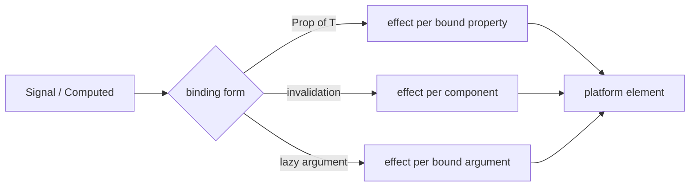

# 0002 - DSL binding

## Status

Stub, 2026-11-25. This is not a design. It records the decisions taken so far and the questions the design must answer. Options are compared with prototypes and measurements, not in this document.

## Decisions taken

### The root as an object

`Reactivity.CreateRoot()` returns an `IDisposable` scope with `Run<T>(Func<T>)`, which can be re-entered. This covers owner capture (Solid `getOwner`/`runWithOwner`) for event handlers and async continuations. The callback `Root` stays as the low-level form.

The two `Root` overloads also carry a temporary MS0063 `NoWarn`. This design may replace them (see the handoff).

### Users rarely see roots

- `Render(App, container)` creates the app root.
- `For` creates one root per item, and `Show` one per branch.
- Components run under the current owner and are not roots.
- Roots that users create are for long-lived state outside the UI.

### Disposal stays synchronous

Disposal is `IDisposable`, not `IAsyncDisposable`, matching Solid 2. Async support (async computeds, `isPending`, possibly async cleanups) belongs to the async phase. Spec 5.4 reserves the flag bits for it.

Metano agrees with this direction: `IAsyncDisposable` gives MS0001 in 3.x.

### No implicit conversion, no combining operators

The core ships no `implicit operator T` and no combining operators. `.Value` stays explicit (spec 6.1).

## Open questions

- **Context.** Should context be resolved through the owner chain, as in Solid? What is the lookup cost on the hot path, and how does it cross a `For` item root?
- **Read abstraction.** Is there a common read interface over `Signal<T>` and `Computed<T>`? Interface dispatch is banned on hot paths (spec 5.3), so a generic constraint, a struct wrapper or a shared base class must be compared.
- **Derived values.** A lambda does not convert to `Prop<T>` (CS1660). What is the cheapest way to write `Text(() => $"Count {count.Value}")` or its equivalent?
- **Props to custom components.** A signal passed to a child is read, and therefore bound, in the child. Is that acceptable, or must the parent bind?
- **Element API.** Generated from WebIDL/webref and Avalonia metadata, or hand-written per platform?
- **Analyzers.** How are reactive reads outside a tracking scope, and missing keys in `For`, reported?
- **Effect handle.** Once `Effect` returns an `IDisposable` (Metano 3.3.0), does the DSL use it, or does it rely on owners only?

## Options to compare

From spec 6.1:

1. **`Prop<T>`.** A single input type, implicit from `T` and from `Signal<T>`/`Computed<T>`. Cost to measure: an allocation per binding if `Prop<T>` is a class, or its size if it is a struct.
2. **Per-component invalidation.** Bindings mark their component dirty, and the component copies signal values into the platform elements on update. Signals passed as props are read, and bound, in the child.
3. **Metano lazy arguments.** A parameter attribute that emits an argument as `() => expr`. It needs a Metano feature request, and it must stay framework-agnostic.

Criteria for the comparison:

- allocations per binding and per update;
- readability of the C# DSL;
- what Metano emits for each form (closures in hot paths are a Metano issue);
- the js-framework-benchmark operations.

## Inputs

- Spec: [0001-reactive-core.md](0001-reactive-core.md), especially 5.3 (hot path), 5.4 (async room) and 6.1 (binding options).
- Metano audit: [0001-reactive-core-ts-audit.md](0001-reactive-core-ts-audit.md).
- Handoff: [../handoff.md](../handoff.md), for the Metano state and the next steps.
- Plan: [../../plans/metano-3.2-effect-handle.md](../../plans/metano-3.2-effect-handle.md), Task 4.
