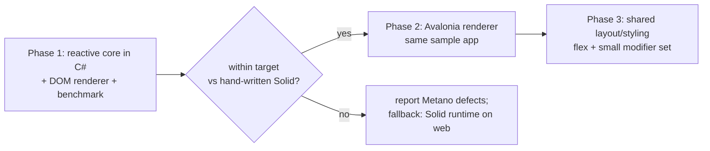

# Handoff — Metanui kickoff (2026-11-24)

Origin: a design discussion in the Metano repo session (wave 8). The maintainer chose to build a toolkit with its own runtime written in C#, rather than wrapping SolidJS, so the same programming model can run on .NET (Avalonia) and on the web (DOM via Metano).

## Decisions taken

1. **Model:** fine-grained reactivity (signals). No virtual DOM, no whole-render diffing, no hook-order rules.
   - Signals map naturally to retained-mode UIs: DOM nodes and Avalonia controls get property-level effects.
   - Microsoft.UI.Reactor is the DSL inspiration only: `Component`, factory functions (`VStack`, `Button`), chained modifiers (`.Padding(24)`), analyzers. Its update model is React-style re-render + diff, which we do NOT copy.
2. **The reactive core is written in C#** and is shared:
   - On .NET it runs natively.
   - On the web it is transpiled by Metano. This makes the hot path of the web runtime Metano-generated code, so benchmarks measure Metano's codegen quality directly.
3. **Renderers per platform:** DOM first (TypeScript target), Avalonia second. Flutter/Dart possibly later, since Metano has an experimental Dart target.
4. **SolidJS is the baseline and plan B.** Compare against hand-written Solid in the js-framework-benchmark app. If the transpiled core cannot get within the target overhead, the web renderer can sit on Solid's runtime behind the same DSL.
5. **Stack:**
   - .NET 11, C# 15.
   - Metano always at the latest NuGet release (`Version="*"` + `scripts/update-metano.sh`).
   - Bun for JS.

## Current state of the repo

- Scaffold only:
  - `global.json` (SDK 11.0.100);
  - `Directory.Build.props` (net11.0, C# 15, warnings as errors, CPM with floating versions);
  - `Directory.Packages.props` (Metano, Metano.Build floating);
  - `dotnet-tools.json` (Metano.Compiler.TypeScript 3.0.2, csharpier);
  - `Metanui.slnx`;
  - a Bun workspace over `targets/js/*`.
- `src/Metanui.Reactive` is a smoke project (one placeholder record) that proves the pipeline. `dotnet build` transpiles it into `targets/js/metanui-reactive` (package.json with `metano-runtime ^3.0.2` peer dep). Replace the placeholder with the real core.
- Copied from Metano's `.claude/`:
  - agents `bob`, `backend-reviewer`, `frontend-reviewer`, `compiler-transpiler-expert`;
  - rules `backend.md`, `frontend.md`;
  - skill `csharp-15`.
  - `compiler-man` is a global agent.
  - Speckit skills were not copied; add them with `.specify/` if spec-driven work is wanted here.
- No git commit yet: review the scaffold, then commit.

## Things to know before coding

- **Metano versions on NuGet today:** `Metano` / `Metano.Compiler.TypeScript` 3.0.2, but **`Metano.Build` latest is 2.10.1**. The build works with it.
  - Check upstream whether `Metano.Build` stopped being published in 3.x (a likely release-pipeline gap). Open a Metano issue if so.
- **Metano 3.0.2 uses Roslyn 5.3**, so it cannot transpile C# 15 `closed` hierarchies or unions. Those land in Metano **3.1.0**, which is held until #738 (closed family = TS union type with a `kind` getter) lands.
  - Until then, web-targeted code avoids `closed`/`union` syntax.
  - .NET-only code (Avalonia renderer, analyzers) can use all of C# 15.
- **Metano emission rules that matter for a runtime:**
  - Avoid patterns that still allocate closures: switch expressions in field initializers, `?? throw` outside switches until Metano wave 8 ships.
  - Records get value equality; signals of records should compare with `Equals`.
  - `List<T>` maps to the runtime List class, not a native array. Use `AsReadOnlyJsArray()` / `JsArray<T>` at DOM boundaries.
  - `[ObjectArgs]` gives `T.create({...})` call shapes. On primary constructors it arrives with Metano wave 8 (#739).
- **Where the DOM API comes from:** C# facades with `[Import]` / `[Emit]` / `[NoEmit]` (TS-only, report MS0051 elsewhere), or a small hand-written TS module imported by the generated code. Keep DOM access out of the shared core.

## Proposed phases

1. **Phase 1, the first work here:**
   - **Design doc** `docs/design/0001-reactive-core.md`:
     - signal / computed / effect / root+owner / cleanup / batch / untrack semantics (cite SolidJS behaviour where we match it);
     - glitch-free propagation, scheduling, error handling;
     - how the API reads in C# (e.g. `State<T>.Value` get/set) and what Metano must emit for it (no closure per read; property access via `[MapProperty]` templates where useful).
   - **Core implementation** in `src/Metanui.Reactive`, with tests that run on .NET and on the transpiled TS (Bun):
     - TUnit on .NET;
     - `bun test` on the generated package;
     - the same scenarios on both.
   - **Minimal DSL + DOM renderer:** elements, text, attributes, events, `Show`, `For` with keys.
   - **Benchmark:** the js-framework-benchmark operations (create 1k/10k rows, update every 10th, swap, select, remove, clear), measured against hand-written Solid, React, Svelte and Inferno. Report time, memory and bundle size.
     - Target: ≤10–15% overhead vs hand-written Solid.
     - Every gap traced to Metano output becomes a Metano issue.
2. **Phase 2:** an Avalonia renderer for the same sample app, plus the analyzers the DSL needs (missing keys, reactive reads outside a tracking scope).
3. **Phase 3:** shared layout and styling with a closed scope: flex plus a small modifier set; platform escape hatches.

## Open questions for the maintainer

1. **Reactive reads in the DSL.** `Text($"Count {count.Value}")` evaluates once. Two options:
   - explicit lambdas `Text(() => ...)`;
   - a generic Metano feature: a parameter attribute (e.g. `[Reactive]` / lazy argument) that emits the argument as `() => expr`.
   The second needs a Metano FR. It is framework-agnostic, so it stays within the "Metano is not Bridge.NET" rule.
2. **Package naming and publishing:** NuGet ids and npm names for the core, DSL and renderers.
3. **Avalonia version** (11.x vs 12 previews on .NET 11).

## Session hygiene

- Worktree per issue once the repo has a remote.
- Never edit generated `targets/js/*/src` by hand.
- Run the reviewers listed in `CLAUDE.md` before declaring work done.
