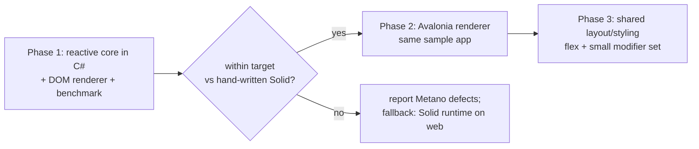

# Handoff — Metanui

## Status (2026-11-25): reactive core done, Metano 3.2.0, effect handle blocked

The reactive core (`src/Metanui.Reactive`) is complete: signals, lazy computeds, split effects, ownership and cleanup, error boundaries, the flush loop and its scheduler port. The same C# scenarios (`src/Metanui.Reactive.Scenarios`) pass on .NET (TUnit) and on the TypeScript that Metano generates (`bun test`). The DSL, the DOM renderer and js-framework-benchmark are not started.

- Plans and phase summaries: `plans/reactive-core.md`, `plans/metano-3.2-effect-handle.md`.
- Design and its deviations from `@solidjs/signals` 2.0.4: `docs/design/0001-reactive-core.md`.
- Generated TypeScript audit and Metano issue status: `docs/design/0001-reactive-core-ts-audit.md`.
- DSL binding stub: `docs/design/0002-dsl-binding.md`.
- Benchmark method, results and findings: `bench/reactivity/README.md` (micro-benchmarks: `bench/micro/README.md`).

### Repo and PRs

The repo is public at github.com/danfma/metanui. PR #1 is `feat/reactive-core` -> `main`. The branch `chore/metano-3.2-effect-handle` stacks on it (its PR targets `feat/reactive-core`).

### Benchmark summary

js-reactivity-benchmark against Solid 2.0.4 and alien-signals 3.2.1, budget 10-15% over Solid. Primary numbers come from the idle host criptomaster (Fedora 45, i9-8950HK), median of three runs; raw outputs are in `bench/reactivity/results/criptomaster-2026-11-25/`. These were measured on Metano 3.1.0 and have not been re-measured on 3.2.0.

- **Bun 1.4.5 (JavaScriptCore): budget met on every test.** Metanui is 25-89% faster than Solid 2.0 and between 29% faster and 15% slower than alien-signals.
- **Node v26.8.2 (V8): budget missed on `createSignals` (+17%) and `cellx1000` (+21%).** On V8 Metanui trails alien-signals on every test, by up to 4.9x (`cellx1000`). The causes are F2 (node layout makes creation slow) and F3 (deep flush, cause open), plus the defensive `try/finally` in `Propagate`/`CheckDirty`.

### Metano

The project is on Metano **3.2.0** (tool, NuGet packages and `metano-runtime`), moved with `scripts/update-metano.sh`. Since #785, Metano warnings fail the build.

**Workarounds removed in 3.2.0:** #768 (setter imports), #772 (native labeled `continue`), #773 (discards), #775, #778 (`root` from TS with any arity), #779 (deconstruction), #764/#765 (`MetanoPackageRoot` and the seeded `version`), #770 (no `[Transpile]` on internal types; internal types are no longer exported from barrels).

**Workarounds kept:** `Missing<T>` for #794; the explicit `Link?` do/while in `ShallowPropagate` for #796.

**Open issues (danfma/metano):** #776, #786, #787, #781, #794, #796, #797, #798, #799, #800. See the audit for the detail of each. In short:

- #796: a `var` local loses `| null`.
- #797: deleting or renaming a `.cs` file leaves a stale `.ts`.
- #798: a redundant `!`.
- #799: `[Name]` acts as a suffix, so it does not clear MS0063 on the two `Root` overloads.
- #800: no `IDisposable` mapping (see below).

**Process notes:**

- **#797 workaround:** after removing or renaming a `.cs` file, delete `.metano-stamp` before building, or the stale `.ts` stays in `targets/js/*/src`.
- **MS0063 `NoWarn`:** the project-scoped `NoWarn` in `src/Metanui.Reactive/Metanui.Reactive.csproj` is temporary. Remove it when #799 lands, or when the 0002 `CreateRoot` design replaces the two `Root` overloads.

### Effect handle (blocked)

`Reactivity.Effect` returning an `IDisposable` handle (maintainer decision: an effect still belongs to its owner, as in Solid) is **blocked on Metano #800**, which targets **3.3.0**. Metano's settled design:

- `IDisposable` maps to a metano-runtime `{ dispose(): void }` interface;
- `using` lowers to try/finally;
- there is no `Symbol.dispose` in 3.x;
- `IAsyncDisposable` gives MS0001.

The work in progress is on branch `wip/effect-handle` (2d7f3dd): the implementation and five scenarios. Resume it on Metano 3.3.0. Note: `Root(d => Reactivity.Effect(...))` binds to `Root<IDisposable>` once `Effect` returns a value.

### The F-9 retry

An errored computed's retry is now a **deferred invalidation**, visible one pass later. An eligible tracked re-read throws the cached error in the current pass and queues the computed on a retry chain in `FlushLoop`. At the start of the next pass, before the commit, the computed is marked Dirty and its subscribers are propagated. Every observer sees the recovery (or the fresh error) one pass later, consistently. This deviates from Solid's F-9 timing and is recorded in spec 4.2.

## Next steps

1. **Effect handle on Metano 3.3.0:** resume `wip/effect-handle` once #800 ships.
2. **`docs/design/0002-dsl-binding.md`:** the DSL binding design, starting from the stub (decisions taken and open questions are there). It must also settle context through the owner chain and a common read abstraction over `Signal<T>` and `Computed<T>`.
3. **V8 optimisation phase:** F2 (node layout) is the lead hypothesis, then F3 (deep flush) and the defensive `try/finally`. A Metano object-creation benchmark showed that derived classes with declared fields are about 2.4x slower to create on V8. Metano was advised to emit declaration-only fields.
4. **Remaining follow-ups:**
   - a `TrackingScope` struct for the save/set/restore of the tracking state, if Metano emits it without allocation;
   - deduplicate `Computed.Update` and `Computed.RunFirst`;
   - split `RootNode` and an error-boundary node;
   - move `Tracking.Pass` into `FlushLoop`;
   - split `ErrorScenarios.cs` by theme;
   - one type per file for `IFlushScheduler`/`ManualFlushScheduler`;
   - missing scenarios: a boundary handler that disposes an owner between the failing effect and the boundary (the error then escapes, spec 4.4), a root disposer called from a boundary handler, a write during a pending resume, the A,B / A,C retry-queue order;
   - rethrow cached errors with `ExceptionDispatchInfo` so the .NET stack of `throw _error` is kept;
   - sanitise the `.cpuprofile` paths before publishing benchmark artefacts.

## Kickoff context (2026-11-24)

Origin: a design discussion in the Metano repo session (wave 8). The maintainer chose to build a toolkit with its own runtime written in C#, rather than wrapping SolidJS, so the same programming model can run on .NET (Avalonia) and on the web (DOM via Metano).

### Decisions taken

1. **Model:** fine-grained reactivity (signals). No virtual DOM, no whole-render diffing, no hook-order rules.
   - Signals map naturally to retained-mode UIs: DOM nodes and Avalonia controls get property-level effects.
   - Microsoft.UI.Reactor is the DSL inspiration only: `Component`, factory functions (`VStack`, `Button`), chained modifiers (`.Padding(24)`), analyzers. Its update model is React-style re-render + diff, which we do NOT copy.
2. **The reactive core is written in C#** and is shared:
   - On .NET it runs natively.
   - On the web it is transpiled by Metano. This makes the hot path of the web runtime Metano-generated code, so benchmarks measure Metano's codegen quality directly.
3. **Renderers per platform:** DOM first (TypeScript target), Avalonia second. Flutter/Dart possibly later, since Metano has an experimental Dart target.
4. **SolidJS is the baseline and plan B.** Compare against hand-written Solid in the js-framework-benchmark app. If the transpiled core cannot get within the target overhead, the web renderer can sit on Solid's runtime behind the same DSL.
5. **Stack:**
   - .NET 11, C# 15.
   - Metano always at the latest NuGet release (`Version="*"` + `scripts/update-metano.sh`).
   - Bun for JS.

### Things to know before coding

- **Metano versions on NuGet today:** `Metano` / `Metano.Compiler.TypeScript` 3.0.2, but **`Metano.Build` latest is 2.10.1**. The build works with it.
  - Check upstream whether `Metano.Build` stopped being published in 3.x (a likely release-pipeline gap). Open a Metano issue if so.
- **Metano 3.0.2 uses Roslyn 5.3**, so it cannot transpile C# 15 `closed` hierarchies or unions. Those land in Metano **3.1.0**, which is held until #738 (closed family = TS union type with a `kind` getter) lands.
  - Until then, web-targeted code avoids `closed`/`union` syntax.
  - .NET-only code (Avalonia renderer, analyzers) can use all of C# 15.
- **Metano emission rules that matter for a runtime:**
  - Avoid patterns that still allocate closures: switch expressions in field initializers, `?? throw` outside switches until Metano wave 8 ships.
  - Records get value equality; signals of records should compare with `Equals`.
  - `List<T>` maps to the runtime List class, not a native array. Use `AsReadOnlyJsArray()` / `JsArray<T>` at DOM boundaries.
  - `[ObjectArgs]` gives `T.create({...})` call shapes. On primary constructors it arrives with Metano wave 8 (#739).
- **Where the DOM API comes from:** C# facades with `[Import]` / `[Emit]` / `[NoEmit]` (TS-only, report MS0051 elsewhere), or a small hand-written TS module imported by the generated code. Keep DOM access out of the shared core.

### Proposed phases

1. **Phase 1, the first work here:**
   - **Design doc** `docs/design/0001-reactive-core.md`:
     - signal / computed / effect / root+owner / cleanup / batch / untrack semantics (cite SolidJS behaviour where we match it);
     - glitch-free propagation, scheduling, error handling;
     - how the API reads in C# (e.g. `State<T>.Value` get/set) and what Metano must emit for it (no closure per read; property access via `[MapProperty]` templates where useful).
   - **Core implementation** in `src/Metanui.Reactive`, with tests that run on .NET and on the transpiled TS (Bun):
     - TUnit on .NET;
     - `bun test` on the generated package;
     - the same scenarios on both.
   - **Minimal DSL + DOM renderer:** elements, text, attributes, events, `Show`, `For` with keys.
   - **Benchmark:** the js-framework-benchmark operations (create 1k/10k rows, update every 10th, swap, select, remove, clear), measured against hand-written Solid, React, Svelte and Inferno. Report time, memory and bundle size.
     - Target: ≤10–15% overhead vs hand-written Solid.
     - Every gap traced to Metano output becomes a Metano issue.
2. **Phase 2:** an Avalonia renderer for the same sample app, plus the analyzers the DSL needs (missing keys, reactive reads outside a tracking scope).
3. **Phase 3:** shared layout and styling with a closed scope: flex plus a small modifier set; platform escape hatches.

### Open questions for the maintainer

1. **Reactive reads in the DSL.** `Text($"Count {count.Value}")` evaluates once. Two options:
   - explicit lambdas `Text(() => ...)`;
   - a generic Metano feature: a parameter attribute (e.g. `[Reactive]` / lazy argument) that emits the argument as `() => expr`.
   The second needs a Metano FR. It is framework-agnostic, so it stays within the "Metano is not Bridge.NET" rule.
2. **Package naming and publishing:** NuGet ids and npm names for the core, DSL and renderers.
3. **Avalonia version** (11.x vs 12 previews on .NET 11).

## Session hygiene

- Worktree per issue once the repo has a remote.
- Never edit generated `targets/js/*/src` by hand.
- Run the reviewers listed in `CLAUDE.md` before declaring work done.
