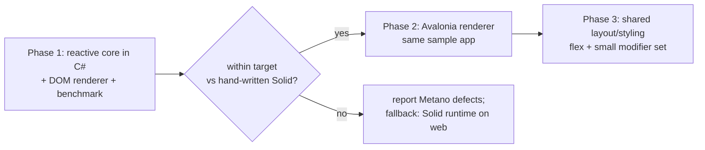

# Handoff — Metanui

## Status (2026-11-26): reactive core done, Metano 4.0.3, effect handle shipped, DSL spikes

The reactive core (`src/Metanui.Reactive`) is complete: signals, lazy computeds, split effects, ownership and cleanup, error boundaries, the flush loop and its scheduler port. The same C# scenarios (`src/Metanui.Reactive.Scenarios`) pass on .NET (TUnit) and on the TypeScript that Metano generates (`bun test`). The DSL, the DOM renderer and js-framework-benchmark are not started.

- Plans and phase summaries: `plans/reactive-core.md`, `plans/metano-3.2-effect-handle.md`.
- Design and its deviations from `@solidjs/signals` 2.0.4: `docs/design/0001-reactive-core.md`.
- Generated TypeScript audit and Metano issue status: `docs/design/0001-reactive-core-ts-audit.md`.
- DSL binding stub: `docs/design/0002-dsl-binding.md`.
- Benchmark method, results and findings: `bench/reactivity/README.md` (micro-benchmarks: `bench/micro/README.md`).

### Repo and PRs

The repo is public at github.com/danfma/metanui. PRs #1 (reactive core) and #2 (Metano 3.2.0) are merged into `main`. PR #3 (Metano 4.0.0 and the effect handle) is merged; the counter spike is on `main` (`spikes/`). The DSL-shapes spike is on branch `spike/dsl-shapes`, with its findings in `docs/design/0002-dsl-binding.md`. PR #4 (Metano 4.0.1) is merged; branches `chore/metano-4.0.2` (4.0.2, a hardened `scripts/update-metano.sh`) and `chore/metano-4.0.3` (4.0.3, on top of it) wait for the merge.

### Benchmark summary

js-reactivity-benchmark against Solid 2.0.4 and alien-signals 3.2.1, budget 10-15% over Solid. Primary numbers come from the idle host criptomaster (Fedora 45, i9-8950HK), median of three runs; raw outputs are in `bench/reactivity/results/criptomaster-2026-11-25/`. These were measured on Metano 3.1.0 and have not been re-measured on 3.2.0.

- **Bun 1.4.5 (JavaScriptCore): budget met on every test.** Metanui is 25-89% faster than Solid 2.0 and between 29% faster and 15% slower than alien-signals.
- **Node v26.8.2 (V8): budget missed on `createSignals` (+17%) and `cellx1000` (+21%).** On V8 Metanui trails alien-signals on every test, by up to 4.9x (`cellx1000`). The causes are F2 (node layout makes creation slow) and F3 (deep flush, cause open), plus the defensive `try/finally` in `Propagate`/`CheckDirty`.

### Metano

The project is on Metano **4.0.3** (tool, NuGet packages and `metano-runtime`), moved with `scripts/update-metano.sh` (then `dotnet build` and `bun install`, in that order: the build rewrites the generated `package.json` files). The script bypasses the NuGet HTTP cache and fails, restoring `dotnet-tools.json`, while the tool and the floating packages resolve different versions (NuGet takes minutes to index a release). Since #785, Metano warnings fail the build, with no exemption left.

**Removed with 3.3.0:** `Missing<T>` (#794), the explicit `Link?` local in `ShallowPropagate` (#796; the emitted TS is unchanged), and the MS0063 `NoWarn` (#799: the void `Root` overload is pinned with `[Name("void")]`, so TS has `rootBody`, `rootVoid` and a typed `root` forwarder). 3.3.0 also builds overload suffixes from parameter names and emits class fields as declarations (#795).

**Metano 4.0.0 (major):**

- C# `using` emits native TS `using` (#817), and every `IDisposable` class gets `[Symbol.dispose]()`.
- Internal classes get their own `$runtimeType`, and members that implement a public interface member lose `@internal` (#819).
- Consumers are transpiled again when a referenced project changes or a file is removed (#818, #797); no stamp workaround is needed.
- Consumer requirements: `"ESNext.Disposable"` in tsconfig `lib` for every TS project that consumes the generated code or metano-runtime; below target ESNext, enable `importHelpers` and depend on `tslib` ^2.6.0. No tsconfig is versioned here (Bun runs the TS directly), so the hand-written tests are not type-checked.
- `MetanoUsingLowering=tryFinally` restores the try/finally lowering if a target needs it (per the Metano 4.0.0 release notes).

**Open issues (danfma/metano):** #781, #786. Fixed in 4.0.3: #822 (claimer shapes not used by Metanui), #826 and #827 (strict-tsc failures in the DSL spike output). #804 is fixed in 4.0.2: initializers lower without IIFEs, which unblocks DSL option D. #821 is fixed in 4.0.1: `OwnerNode.dispose` keeps `@internal` and `EffectNode` emits its own `override dispose()`, so `Computed<T>` exposes no `dispose()`.

### Effect handle

`Reactivity.Effect` returns an `IDisposable` handle (spec 4.3): the effect node itself, so nothing is allocated. The handle is optional; an effect still belongs to its owner, as in Solid. In TS it has `dispose()` and `[Symbol.dispose]()` (`using h = Reactivity.effect(...)` works, see `tests/js/reactive/effect-handle.test.ts`) and passes `IDisposable$runtimeType.test`. `IAsyncDisposable` is still MS0001. `Root(d => Reactivity.Effect(...))` now binds to `Root<IDisposable>`.

### The F-9 retry

An errored computed's retry runs at the **start of the next flush pass**, not inline (spec 4.2). An eligible tracked re-read throws the cached error in the current pass, links its observer, then queues the computed on a retry chain in `FlushLoop`. At the start of the next pass, before the commit and with no graph walk in progress, the flush reruns each queued computed that is still errored and not disposed (`ComputedNode.RetryAtPassStart`):

- **Recovery:** its subscribers are propagated like a signal commit, so every observer that runs in that pass sees the recovered value.
- **Fails again:** the new error is kept silently and nobody is notified. An always-failing computed costs one observer run and one boundary call per change, as in Solid. An observer keeps the first error instance until it runs again for another reason (accepted trade-off, pinned by a scenario).
- **No longer errored** (an unwatch cleared the error, or a read recomputed it): skipped.

Known behaviour, stated precisely:

- **Queue-once guard:** a computed already on the chain is not queued again (`IsQueuedForRetry`: it has a next link, or it is the tail). Both branches are covered by "errored computed re-read by several observers is retried once" (A,B then B,A). A dedicated A,B / A,C scenario would exercise the same non-tail branch; without the guard, re-queuing A would link the tail back to A and loop the chain.
- **Retry as an extra pass (untested):** a retry queued in the last pass the budget allows counts as work, so that flush stops with the pass-limit error and discards the retry with the pending writes. Confirm with a scenario before relying on it.

## Known issue: reentrant read from a cleanup during a producer's rerun

Parked for a follow-up; it predates the Metano 3.2 branch (reproduced on 2150c1e and c3af7d1 with the shape below) and needs its own design decision.

- **Shape:** `trigger = Signal(0)`; `other = Signal(0)`; `stale = Computed(() => { OnCleanup(() => seen = reader.Peek()); return other.Value; })`; `producer = Computed(() => trigger.Value == 0 ? stale.Value : 5)`; `reader = Computed(() => producer.Value + 1)`. Read `reader.Peek()` (1), then `trigger.Value = 1; Flush(); producer.Peek()`.
- **Observed:** `producer` reruns and drops `stale`; its end-of-run unlink unwatches `stale`, whose cleanup reads `reader`. `reader` is pending, but `producer` has not shallow-propagated its change yet, so `reader`'s dirty check finds nothing dirty and clears its pending mark; `producer`'s propagation then skips it. `reader.Peek()` returns 1 instead of 6, and keeps doing so until another change.
- **Cause:** unwatch cleanups (Solid `unobserved`) run user code in the middle of a computed's update, before its propagation; alien-signals has no such cleanups.
- **Candidate fixes:** defer the disposal an unwatch does until the producer has propagated; or make the producer's propagation also reach subscribers that are no longer pending (a cleared mark set during its own update).

## Next steps

1. **`docs/design/0002-dsl-binding.md`:** the DSL binding design, starting from the stub (decisions taken and open questions are there). It must also settle context through the owner chain, a common read abstraction over `Signal<T>` and `Computed<T>`, and the re-entrant `Run` rules. The `CreateRoot` scope is `IDisposable`, which Metano supports (native `using` since 4.0.0).
2. **V8 optimisation phase:** F2 (node layout) is the lead hypothesis, then F3 (deep flush) and the defensive `try/finally`. A Metano object-creation benchmark showed that derived classes with declared fields are about 2.4x slower to create on V8. Metano was advised to emit declaration-only fields.
3. **Remaining follow-ups:**
   - a `TrackingScope` struct for the save/set/restore of the tracking state, if Metano emits it without allocation;
   - deduplicate `Computed.Update` and `Computed.RunFirst`;
   - split `RootNode` and an error-boundary node;
   - move `Tracking.Pass` into `FlushLoop`;
   - split `ErrorScenarios.cs` by theme;
   - one type per file for `IFlushScheduler`/`ManualFlushScheduler`;
   - missing scenarios: a boundary handler that disposes an owner between the failing effect and the boundary (the error then escapes, spec 4.4), the A,B / A,C retry-queue order (optional, see the F-9 section), a retry queued in the last allowed pass;
   - rethrow cached errors with `ExceptionDispatchInfo` so the .NET stack of `throw _error` is kept;
   - sanitise the `.cpuprofile` paths before publishing benchmark artefacts.

## Kickoff context (2026-11-24)

Origin: a design discussion in the Metano repo session (wave 8). The maintainer chose to build a toolkit with its own runtime written in C#, rather than wrapping SolidJS, so the same programming model can run on .NET (Avalonia) and on the web (DOM via Metano).

### Decisions taken

1. **Model:** fine-grained reactivity (signals). No virtual DOM, no whole-render diffing, no hook-order rules.
   - Signals map naturally to retained-mode UIs: DOM nodes and Avalonia controls get property-level effects.
   - Microsoft.UI.Reactor is the DSL inspiration only: `Component`, factory functions (`VStack`, `Button`), chained modifiers (`.Padding(24)`), analyzers. Its update model is React-style re-render + diff, which we do NOT copy.
2. **The reactive core is written in C#** and is shared:
   - On .NET it runs natively.
   - On the web it is transpiled by Metano. This makes the hot path of the web runtime Metano-generated code, so benchmarks measure Metano's codegen quality directly.
3. **Renderers per platform:** DOM first (TypeScript target), Avalonia second. Flutter/Dart possibly later, since Metano has an experimental Dart target.
4. **SolidJS is the baseline and plan B.** Compare against hand-written Solid in the js-framework-benchmark app. If the transpiled core cannot get within the target overhead, the web renderer can sit on Solid's runtime behind the same DSL.
5. **Stack:**
   - .NET 11, C# 15.
   - Metano always at the latest NuGet release (`Version="*"` + `scripts/update-metano.sh`).
   - Bun for JS.

### Things to know before coding

Current facts (Metano 4.0.3):

- `Metano`, `Metano.Build.TypeScript` and the `Metano.Compiler.TypeScript` tool are all on 4.0.3, and `metano-runtime` on ^4.0.3; `scripts/update-metano.sh` moves them together.
- Metano warnings fail the build (#785), with no exemption.
- `closed` hierarchies and unions are transpiled since Metano 3.1.0; check what the current release emits before using them in web-targeted code.
- The open issues (#781, #786) are in "Metano" above; the per-release re-checks are in the audit, sections 9 to 11. No Metano workaround is kept.

Historical (kickoff, Metano 3.0.2; kept for context, superseded by the facts above):

- `Metano.Build` stopped at 2.10.1 while `Metano` was 3.0.2; 3.0.2 used Roslyn 5.3 and could not transpile `closed`/unions.
- **Metano emission rules that matter for a runtime** (re-check against the current release):
  - Avoid patterns that still allocated closures: switch expressions in field initializers, `?? throw` outside switches (spec 5.3).
  - Records get value equality; signals of records should compare with `Equals`.
  - `List<T>` maps to the runtime List class, not a native array. Use `AsReadOnlyJsArray()` / `JsArray<T>` at DOM boundaries.
  - `[ObjectArgs]` gives `T.create({...})` call shapes; on primary constructors it was due with Metano wave 8 (#739).
- **Where the DOM API comes from:** C# facades with `[Import]` / `[Emit]` / `[NoEmit]` (TS-only, report MS0051 elsewhere), or a small hand-written TS module imported by the generated code. Keep DOM access out of the shared core.

### Proposed phases

1. **Phase 1, the first work here:**
   - **Design doc** `docs/design/0001-reactive-core.md`:
     - signal / computed / effect / root+owner / cleanup / batch / untrack semantics (cite SolidJS behaviour where we match it);
     - glitch-free propagation, scheduling, error handling;
     - how the API reads in C# (e.g. `State<T>.Value` get/set) and what Metano must emit for it (no closure per read; property access via `[MapProperty]` templates where useful).
   - **Core implementation** in `src/Metanui.Reactive`, with tests that run on .NET and on the transpiled TS (Bun):
     - TUnit on .NET;
     - `bun test` on the generated package;
     - the same scenarios on both.
   - **Minimal DSL + DOM renderer:** elements, text, attributes, events, `Show`, `For` with keys.
   - **Benchmark:** the js-framework-benchmark operations (create 1k/10k rows, update every 10th, swap, select, remove, clear), measured against hand-written Solid, React, Svelte and Inferno. Report time, memory and bundle size.
     - Target: ≤10–15% overhead vs hand-written Solid.
     - Every gap traced to Metano output becomes a Metano issue.
2. **Phase 2:** an Avalonia renderer for the same sample app, plus the analyzers the DSL needs (missing keys, reactive reads outside a tracking scope).
3. **Phase 3:** shared layout and styling with a closed scope: flex plus a small modifier set; platform escape hatches.

### Open questions for the maintainer

1. **Reactive reads in the DSL.** `Text($"Count {count.Value}")` evaluates once. Two options:
   - explicit lambdas `Text(() => ...)`;
   - a generic Metano feature: a parameter attribute (e.g. `[Reactive]` / lazy argument) that emits the argument as `() => expr`.
   The second needs a Metano FR. It is framework-agnostic, so it stays within the "Metano is not Bridge.NET" rule.
2. **Package naming and publishing:** NuGet ids and npm names for the core, DSL and renderers.
3. **Avalonia version** (11.x vs 12 previews on .NET 11).

## Session hygiene

- Worktree per issue once the repo has a remote.
- Never edit generated `targets/js/*/src` by hand.
- Run the reviewers listed in `CLAUDE.md` before declaring work done.
