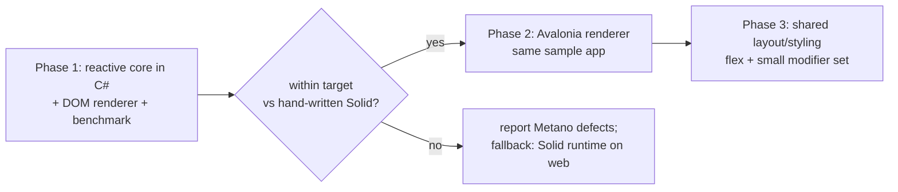

# Handoff — Metanui

## Status (2026-11-25): Phase 1 reactive core done

The reactive core (`src/Metanui.Reactive`) is complete on branch `feat/reactive-core`: signals, lazy computeds, split effects, ownership and cleanup, error boundaries, the flush loop and its scheduler port. The same C# scenarios (`src/Metanui.Reactive.Scenarios`) pass on .NET (TUnit) and on the TypeScript that Metano 3.1.0 generates (`bun test`). The DSL, the DOM renderer and js-framework-benchmark are not started.

- Plan and phase summaries: `plans/reactive-core.md`.
- Design and its deviations from `@solidjs/signals` 2.0.4: `docs/design/0001-reactive-core.md`.
- Generated TypeScript audit and Metano findings: `docs/design/0001-reactive-core-ts-audit.md`.
- Benchmark method, results and findings: `bench/reactivity/README.md` (micro-benchmarks: `bench/micro/README.md`).

### Benchmark summary

js-reactivity-benchmark against Solid 2.0.4 and alien-signals 3.2.1, budget 10–15% over Solid. Primary numbers come from the idle host criptomaster (Fedora 45, i9-8950HK), median of three runs; raw outputs are in `bench/reactivity/results/criptomaster-2026-11-25/`.

- **Bun 1.4.5 (JavaScriptCore): budget met on every test.** Metanui is 25–89% faster than Solid 2.0 (Solid's eager memos inflate the `lazy80%` gaps) and between 29% faster and 15% slower than alien-signals.
- **Node v26.8.2 (V8): budget missed on `createSignals` (+17%, Solid's own times are noisy) and `cellx1000` (+21%).** On V8 Metanui trails alien-signals on every test, by up to 4.9× (`cellx1000`). The causes are F2 (node layout makes creation slow) and F3 (deep flush, cause open), plus the defensive `try/finally` in `Propagate`/`CheckDirty` (about 1.5–3 ns per call on V8).

### Open Metano issues (danfma/metano)

| Issue | What | State in this repo |
|---|---|---|
| #768 | No import for a type referenced only in a property setter | Workaround in `Signal.cs` (`// Metano #768`); fixed on Metano's wave-9 branch |
| #772 | Labeled statements dropped | Workaround in `DependencyGraph.cs`; fixed on wave-9 |
| #773 | Discard `_ = expr` emitted verbatim | Workaround (`Read` helpers in scenarios); fixed on wave-9 |
| #774 | `T? x = nonNull;` loses `\| null` | Workaround in `DependencyGraph.ShallowPropagate`; fixed on wave-9 |
| #775 | `x!.A` does not narrow `x` | No workaround left; fixed on wave-9 |
| #770 | Internal types need `[Transpile]` | Every internal transpiled type carries it. A reference to an internal type without it is emitted with no import and no diagnostic (seen again in the final fix wave) |
| #776 | Import of a renamed type lost | Did not reproduce |
| #778 | Overload dispatcher with a dead branch; `root(...)` throws for zero-parameter TS callbacks | No workaround needed for C# callers |
| #779 | Tuple deconstruction unsupported | Workaround in `OwnershipScenarios.cs` |
| #785 | Metano warnings never fail the build; up-to-date stamp written after a failed run | Open |
| #786 | metano-runtime's Temporal polyfill clashes with tsgo | Open |
| #787 | Emission noise (N1–N5, N7, N8 of the audit) | Open |
| FR after #780 | `@internal` for internal types | Internal types are still exported from the generated barrels. Rule until it lands: hand-written TS imports only the public symbols (`Reactivity`, `Signal`, `Computed`, `IFlushScheduler`, `ManualFlushScheduler`) |
| not filed yet | `null!`/`default!` of a non-generic reference type loses its `!` | Workaround in `FlushScenarios.cs` (`// Metano:`), from the final fix wave |

### Metano 3.2.0 follow-up

Metano 3.2.0 is published, but this branch stays on 3.1.0 (tool pin and lock files). `Metano` and `Metano.Build.TypeScript` float (`Version="*"`), so a forced restore (`dotnet restore --force-evaluate`, `scripts/update-metano.sh`) picks 3.2.0 without anyone choosing it. 3.2.0 turns Metano warnings into build failures (#785), so the build may fail on warnings that 3.1.0 let through. Make the upgrade one deliberate commit:

1. run `scripts/update-metano.sh` and fix what fails;
2. remove every workaround the audit ledger lists (`// Metano #<issue>` comments), re-probing each issue first;
3. re-check the root dispatcher (#778) and the `@internal` export of internal types;
4. rerun both suites, strict tsc and the benchmark correctness tests, and re-measure.

## Next steps

1. **Metano 3.2.0 upgrade** (above).
2. **`docs/design/0002-dsl-binding.md`:** how the DSL binds reactive values to element properties. Compare a single `Prop<T>` input type, per-component invalidation and a Metano lazy-argument feature (spec 6.1). The same design must settle the owner capture API (`getOwner`/`runWithOwner`), context, and a common read abstraction over `Signal<T>` and `Computed<T>` (architecture review A4).
3. **A separate V8 optimisation phase:** F2 (node layout), F3 (deep flush), and the defensive `try/finally`.
4. **Follow-ups from the final review:**
   - a `TrackingScope` struct for the save/set/restore of the tracking state, if Metano emits it without allocation;
   - deduplicate `Computed.Update` and `Computed.RunFirst`;
   - split `RootNode` and an error-boundary node;
   - move `Tracking.Pass` into `FlushLoop`;
   - split `ErrorScenarios.cs` by theme;
   - one type per file for `IFlushScheduler`/`ManualFlushScheduler`;
   - missing scenarios: a boundary handler that disposes an owner between the failing effect and the boundary (the error then escapes, spec 4.4), a root disposer called from a boundary handler, a write during a pending resume;
   - rethrow cached errors with `ExceptionDispatchInfo` so the .NET stack of `throw _error` is kept;
   - sanitise the `.cpuprofile` paths before publishing benchmark artefacts.

## Kickoff context (2026-11-24)

Origin: a design discussion in the Metano repo session (wave 8). The maintainer chose to build a toolkit with its own runtime written in C#, rather than wrapping SolidJS, so the same programming model can run on .NET (Avalonia) and on the web (DOM via Metano).

### Decisions taken

1. **Model:** fine-grained reactivity (signals). No virtual DOM, no whole-render diffing, no hook-order rules.
   - Signals map naturally to retained-mode UIs: DOM nodes and Avalonia controls get property-level effects.
   - Microsoft.UI.Reactor is the DSL inspiration only: `Component`, factory functions (`VStack`, `Button`), chained modifiers (`.Padding(24)`), analyzers. Its update model is React-style re-render + diff, which we do NOT copy.
2. **The reactive core is written in C#** and is shared:
   - On .NET it runs natively.
   - On the web it is transpiled by Metano. This makes the hot path of the web runtime Metano-generated code, so benchmarks measure Metano's codegen quality directly.
3. **Renderers per platform:** DOM first (TypeScript target), Avalonia second. Flutter/Dart possibly later, since Metano has an experimental Dart target.
4. **SolidJS is the baseline and plan B.** Compare against hand-written Solid in the js-framework-benchmark app. If the transpiled core cannot get within the target overhead, the web renderer can sit on Solid's runtime behind the same DSL.
5. **Stack:**
   - .NET 11, C# 15.
   - Metano always at the latest NuGet release (`Version="*"` + `scripts/update-metano.sh`).
   - Bun for JS.

### Things to know before coding

- **Metano versions on NuGet today:** `Metano` / `Metano.Compiler.TypeScript` 3.0.2, but **`Metano.Build` latest is 2.10.1**. The build works with it.
  - Check upstream whether `Metano.Build` stopped being published in 3.x (a likely release-pipeline gap). Open a Metano issue if so.
- **Metano 3.0.2 uses Roslyn 5.3**, so it cannot transpile C# 15 `closed` hierarchies or unions. Those land in Metano **3.1.0**, which is held until #738 (closed family = TS union type with a `kind` getter) lands.
  - Until then, web-targeted code avoids `closed`/`union` syntax.
  - .NET-only code (Avalonia renderer, analyzers) can use all of C# 15.
- **Metano emission rules that matter for a runtime:**
  - Avoid patterns that still allocate closures: switch expressions in field initializers, `?? throw` outside switches until Metano wave 8 ships.
  - Records get value equality; signals of records should compare with `Equals`.
  - `List<T>` maps to the runtime List class, not a native array. Use `AsReadOnlyJsArray()` / `JsArray<T>` at DOM boundaries.
  - `[ObjectArgs]` gives `T.create({...})` call shapes. On primary constructors it arrives with Metano wave 8 (#739).
- **Where the DOM API comes from:** C# facades with `[Import]` / `[Emit]` / `[NoEmit]` (TS-only, report MS0051 elsewhere), or a small hand-written TS module imported by the generated code. Keep DOM access out of the shared core.

### Proposed phases

1. **Phase 1, the first work here:**
   - **Design doc** `docs/design/0001-reactive-core.md`:
     - signal / computed / effect / root+owner / cleanup / batch / untrack semantics (cite SolidJS behaviour where we match it);
     - glitch-free propagation, scheduling, error handling;
     - how the API reads in C# (e.g. `State<T>.Value` get/set) and what Metano must emit for it (no closure per read; property access via `[MapProperty]` templates where useful).
   - **Core implementation** in `src/Metanui.Reactive`, with tests that run on .NET and on the transpiled TS (Bun):
     - TUnit on .NET;
     - `bun test` on the generated package;
     - the same scenarios on both.
   - **Minimal DSL + DOM renderer:** elements, text, attributes, events, `Show`, `For` with keys.
   - **Benchmark:** the js-framework-benchmark operations (create 1k/10k rows, update every 10th, swap, select, remove, clear), measured against hand-written Solid, React, Svelte and Inferno. Report time, memory and bundle size.
     - Target: ≤10–15% overhead vs hand-written Solid.
     - Every gap traced to Metano output becomes a Metano issue.
2. **Phase 2:** an Avalonia renderer for the same sample app, plus the analyzers the DSL needs (missing keys, reactive reads outside a tracking scope).
3. **Phase 3:** shared layout and styling with a closed scope: flex plus a small modifier set; platform escape hatches.

### Open questions for the maintainer

1. **Reactive reads in the DSL.** `Text($"Count {count.Value}")` evaluates once. Two options:
   - explicit lambdas `Text(() => ...)`;
   - a generic Metano feature: a parameter attribute (e.g. `[Reactive]` / lazy argument) that emits the argument as `() => expr`.
   The second needs a Metano FR. It is framework-agnostic, so it stays within the "Metano is not Bridge.NET" rule.
2. **Package naming and publishing:** NuGet ids and npm names for the core, DSL and renderers.
3. **Avalonia version** (11.x vs 12 previews on .NET 11).

## Session hygiene

- Worktree per issue once the repo has a remote.
- Never edit generated `targets/js/*/src` by hand.
- Run the reviewers listed in `CLAUDE.md` before declaring work done.
