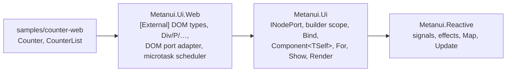

# DSL v1: keyed Map, platform elements and effect bindings

Ship the first usable Metanui UI layer, chosen in `docs/design/0002-dsl-binding.md` as option H. Builder lambdas give the platform element itself; a binding is an effect that writes a plain property; a component prop that its `Render` binds is a `Prop<T>` (a static value or a reader, no signal inside). The keyed `Map` primitive comes first in the reactive core, because `For` cannot be built without it (spike finding). The web adapter ships; Avalonia comes later. A `Counter` and a `CounterList` sample show it working.

> **For agentic workers:** REQUIRED SUB-SKILL: superpowers:subagent-driven-development. Steps use checkbox (`- [ ]`) syntax.

**Design:** `docs/design/0002-dsl-binding.md` (spike findings, options A–H). **Core spec:** `docs/design/0001-reactive-core.md`. **Context:** `docs/handoff.md`. **Spike reference:** branch `spike/dsl-shapes`, `spikes/Metanui.Spike.Dsl/Variants/Direct` and `spikes/dsl-web/counter-list.smoke.test.ts`.

## For Future Agents
As work proceeds, mark checkboxes `- [x]`. When a phase is done, set its status to `Complete` and write its Phase Summary: what was done, key decisions, and anything needed to continue with zero context. Run the phase's Verification Plan and record the result before moving on. When all phases are done, fill in the Final Recap and the Deployment Plan.

Branch: `feat/dsl-v1`, from `main` after the maintainer merges `chore/metano-4.0.3` (which carries 4.0.2 too). Direct pushes to `main` are blocked: integration goes through a PR or the maintainer's merge.

## Global Constraints

- net11.0, C# 15, TreatWarningsAsErrors, Central Package Management, Bun only, never hand-edit `targets/js/*/src`.
- Metano always at its latest release, moved with `scripts/update-metano.sh` (then `dotnet build`, then `bun install`). New Metano defects go to the Metano Claude session (`ListAgents`, currently `metano-56`) with a minimal repro, never worked around silently; a visible workaround is marked `// Metano #<issue>`.
- Use C# semantics, not JS ones: collections are `IReadOnlyList<T>`, equality is `EqualityComparer<T>.Default` unless a key selector is given.
- Hot paths (spec 0001 §5.3) allocate nothing avoidable: no closures, boxing or interface dispatch per update.
- Reactive semantics stay Solid 2.0.4 (`@solidjs/signals`): reads return the committed value until the flush, writes inside a computation throw, roots and effects cannot be created in an apply.
- Reviews at every phase end, in parallel: `compiler-man`, `bob`, `backend-reviewer` (.cs), `frontend-reviewer` (hand-written .ts), `architecture-reviewer`. A `REPROVADO` blocks the phase; `APROVADO COM RESSALVAS` items are reported to the maintainer.
- Commits: conventional, infinitive verb, ending with the `Co-Authored-By` line.

## Layering

`Metanui.Ui` never names a DOM type. Its port works on `object` node handles, so users never see a node type parameter. `Metanui.Ui.Web` is the only place that knows the DOM.

---

## Phase 0: Prerequisites and design record
Status: Complete

- [x] Confirm `main` contains `chore/metano-4.0.3` (`git log main --oneline | grep "upgrade Metano to 4.0.3"`); if not, stop and ask the maintainer to merge it.
- [x] Create `feat/dsl-v1` from `main`. Bring `docs/design/0002-dsl-binding.md` and this plan from `spike/dsl-shapes` (`git checkout spike/dsl-shapes -- docs/design/0002-dsl-binding.md plans/dsl-v1.md`); do not bring `spikes/Metanui.Spike.Dsl` or `spikes/dsl-web`.
- [x] Rewrite the "Proposed design (v1)" section of 0002 for option H: platform elements, fused `Bind(Action)` and split `Bind(compute, apply)`, component props (signal-backed in this first draft, superseded by Phase 5: `Prop<T>`), plain props documented as init-only, `For` over `Map`, `Show`, the `INodePort`, `Metanui.Ui` / `Metanui.Ui.Web`, and the out-of-v1 list (Avalonia, WebIDL generation, context, analyzers, `[Prop]` source generator, `ReactiveList<T>`, interpolated-template binding until Metano #828, js-framework-benchmark). Set the status to "Accepted, 2026-11-27".
- [x] Update `docs/handoff.md`: status line and next steps point to this plan.

### Verification Plan
- `git diff main --stat` shows only `docs/` and `plans/` changes.
- `grep -n "Accepted, 2026-11-27" docs/design/0002-dsl-binding.md` finds the status line.

### Phase Summary
Done 2026-11-27. `main` holds Metano 4.0.3 (pushed by the agent; the maintainer allows the agent to merge and rebase). `feat/dsl-v1` branches from it with only `docs/` and `plans/` changes. 0002's v1 section now describes option H (it was renamed "Design (v1)", status "Accepted, 2026-11-27"); the rest of 0002 keeps the stub and the spike record. Verification: `git diff main --stat` lists `docs/design/0002-dsl-binding.md`, `docs/handoff.md`, `plans/dsl-v1.md` only; the grep finds the status line.

## Phase 1: Keyed `Map` in the reactive core
Status: Complete

**Files:** `docs/design/0001-reactive-core.md` (new section), `src/Metanui.Reactive/Reactivity.cs` (public entry), a new internal node under `src/Metanui.Reactive/` (e.g. `Mapping/KeyedMap.cs`), `src/Metanui.Reactive.Scenarios/MapScenarios.cs`, `tests/Metanui.Reactive.Tests`, `tests/js/reactive`.

- [x] Spec it first in 0001 (new section after effects), against Solid 2.0.4 `mapArray`:
  - `public static Func<IReadOnlyList<TResult>> Map<T, TResult>(Func<IReadOnlyList<T>> source, Func<T, TResult> map)` keys by `EqualityComparer<T>.Default` (class: reference, record: value).
  - Overload with `Func<T, TKey> key` (keys by `EqualityComparer<TKey>.Default`).
  - Each mapped item runs `map` once, untracked, under its own owner that survives the source's reruns; an item whose key leaves the list has its owner disposed (cleanups run); a kept item keeps its result and state; the result list follows the new order.
  - Duplicate keys pair in order (the n-th occurrence of a key in the new list reuses the n-th one of the old list), as Solid pairs repeated references; no exception.
  - Disposal of the owner that created the `Map` disposes every item owner.
  - The source read is tracked; `map` reads are not tracked by the `Map` node.
  - Equality of the result list: a new `IReadOnlyList<TResult>` only when the mapping changed (order, insertions, removals); an unchanged source rerun keeps the previous list instance so observers do not rerun.
- [x] Implement the node: reconcile old and new keys in O(n) with a `Dictionary<TKey, …>` plus an in-order duplicate queue; no per-item closure on the update path beyond `map` itself. Item owners are created by the node, not in an effect apply or compute that would dispose them.
- [x] Scenarios (run on .NET and Bun through the scenarios package): add/append, remove first/middle/last, reorder, replace all, clear, duplicate records, key selector with mutable items, owner disposal disposes items, cleanups run once per removed item, unchanged rerun keeps the list instance, item state (a signal created in `map`) survives unrelated additions.
- [x] Reproduce the spike failure as a scenario first (items created in a compute die on rerun), then show `Map` passes it.
- [x] Bench: add a `Map` case to `bench/micro` (append 1 000 items, swap two, remove one) and record the numbers in the audit doc.

### Verification Plan
- `dotnet build` → 0 warnings, 0 errors; `dotnet test` → all pass (121 + the new Map scenarios).
- `bun install && bun test` → all pass, same scenario count as .NET for the Map group.
- Strict tsc over `targets/js/metanui-reactive/src` and the scenarios (customConditions `bun`, lib ES2022 + ESNext.Disposable) → 0 diagnostics.
- `scripts/bench-reactivity.sh test` → 12/12 pass (no regression in the core).
- Reviewers run, none `REPROVADO`.

### Phase Summary
Done 2026-11-27 (commits 517204f..786496f). `Reactivity.Map(source, map)` and `Map(source, key, map)` in the core (spec 0001 §4.8, placed at the end of §4 to avoid renumbering): `Mapping/KeyedMap.cs` reconciles keys (prefix trim, suffix trim guarded so duplicate keys keep in-order pairing — a documented deviation from Solid), one `Ownership/ScopeOwner` per item plus one for the list, both outside the computed so items survive reruns; `ScopeOwner.CatchesErrors` keeps §4.5 (cleanup errors never reach a handler) while `map` runs. 22 Map scenarios on .NET (143) and Bun (149), strict tsc 0, bench correctness 12/12. Micro bench vs Solid mapArray (1 000 rows): append ~56 vs 38 µs, swap ~103 vs 11 µs (no small-move fast path — follow-up), remove ~37 vs 15 µs (audit §14).
Metano: #840 (`new T[n]`) worked around with `List<T>`; four more defects reported 2026-11-27 (ctor type args dropped, typed delegate local loses annotation, `out` arg tuple per call, `EqualityComparer<T>` field type unmapped), sites marked #838, #843, #844 and #845. TS callers pass a metano-runtime list (`List.adopt`), not a JS array — relevant to Phase 3's TS surface. Reviews: all five ran; compiler-man's Spec ❌ was fixed in one round; minors are deferred in the SDD ledger for the final review.

## Phase 2: `Signal<T>.Update`
Status: Complete

- [x] Spec in 0001: `public void Update(Func<T, T> update)` applies `update` to the latest value including a pending write of the same flush, queues the result as the pending write, and keeps every other write rule (throws inside a computation, equality skips the commit). Matches Solid 2.0's function setter.
- [x] Implement in `Signal.cs` without allocating when there is no pending write.
- [x] Scenarios: two `Update(c => c + 1)` in one tick give +2; `Update` after a plain write builds on it; `Update` inside a computation throws; equality skip.

### Verification Plan
- Same build, test and strict-tsc checks as Phase 1, all green.
- Reviewers run, none `REPROVADO`.

### Phase Summary
Done 2026-11-27 (commits ac583a9..e30373e). `Signal<T>.Update(Func<T,T>)` chains on a pending write of the same flush (0001 §4.1), allocates nothing, throws inside a computation before calling the function; deviation from Solid documented: it returns void (Solid's setter returns the written value). Metano emitted duplicate TS members for an override plus a same-named overload, so the internal graph method `Update` became `Refresh` (Computed's private `Refresh` → `RefreshIfStale`), kept after the Metano fix (#841). .NET 147, Bun 153, strict tsc 0, bench 12/12. Reviews: backend REPROVADO for one blank line, compiler-man two stale names — fixed in one round; minors deferred in the SDD ledger.

## Phase 3: `Metanui.Ui` (platform-neutral layer)
Status: Complete

**Files:** `src/Metanui.Ui/` (new project, `[EmitPackage]` → `targets/js/metanui-ui`), `src/Metanui.Ui.Scenarios/` (scenarios with a fake port, transpiled like `Metanui.Reactive.Scenarios`), `tests/Metanui.Ui.Tests`, `tests/js/ui`, `Metanui.slnx`, root `package.json` workspaces.

- [x] `INodePort`: `object CreateText(string text)`, `void SetText(object text, string value)`, `void Insert(object parent, object node, object? anchor)`, `void Remove(object parent, object node)`, `object CreateAnchor()` (comment node on the web). Elements are created by the platform factories, not by the port.
- [x] Builder scope: the ambient current parent and the port, used by platform factories through a small `Builder.Create(object node, Action build)`-style API, restored in `finally`. `Add(...)` outside a builder throws with a clear message.
- [x] Bindings: `Bind(Action write)` (fused: write in the tracked compute, for platform properties) and `Bind<T>(Func<T> compute, Action<T> apply)` (split: write in the apply, equality skips unchanged values, required for signal-backed props). XML docs state which one to use and why (a signal write in a fused bind throws).
- [x] `Component<TSelf>`: props are plain properties. *(Superseded by Phase 5 (`Prop<T>`): the signal-backed reactive props and the init-only wording below were replaced; a prop that `Render` binds is a `Prop<T>`, a plain property is read once.)* Reactive props are signal-backed (`get => _x.Value; set => _x.Value = value`), documented; plain props are init-only. Children are collected into a fragment and placed with the port (no wrapper element). Each component exposes a one-line static factory until Metano #832 lands (`// Metano #832`).
- [x] `For<T>(Func<IReadOnlyList<T>> items, Func<T, …> render)` and the keyed overload, on `Reactivity.Map`, placed between two anchors with `Insert`/`Remove` and minimal moves.
- [x] `Show(Func<bool> when, Action then, Action? otherwise = null)`, each branch under its own root, swapped between anchors.
- [x] `Ui.Render(Action build, object container, INodePort port)` returns `IDisposable` that disposes the whole tree and removes its nodes.
- [x] Scenarios with a fake C# port that records the node tree as text: static tree, fused and split binds, signal-backed props, init-only prop documented behaviour, `For` add/remove/reorder keeps item state and disposes removed items, `Show` toggling disposes the hidden branch, `Render` dispose removes everything, `Add` outside a builder throws.

### Verification Plan
- `dotnet build` / `dotnet test` green; `bun test` runs the same Ui scenarios green.
- Strict tsc over `targets/js/metanui-ui/src` and its scenarios → 0 diagnostics (except open Metano issues, each listed with its number).
- Reviewers run, none `REPROVADO`; `architecture-reviewer` confirms `Metanui.Ui` has no DOM reference.

### Phase Summary
Done 2026-11-27 (commits fc7d564..93f5665). `src/Metanui.Ui` (package metanui-ui): `INodePort` (CreateText/SetText/CreateAnchor/Insert/Remove on object handles); `Builder` (adapter extension point: one ambient `Scope` = insertion point (parent, before, collector) + rejection message, saved/restored in `finally`; `Create<TNode>`, `Add`); facade `View` (named `View` because `Ui` resolves to the namespace inside `Metanui.*`): `Bind` fused and split (equality skip), `Text`, `For` (plain/keyed, on `Reactivity.Map`, one end anchor per item, intrusive linked list, `Arrange` moves only out-of-place items; inserts and appends move nothing existing), `Show` (branch under its own root, one end anchor), `Mount`, `Render` (returns IDisposable, removes every node). `Component<TSelf>`: plain properties as props, `Content` render prop (elements created in the props lambda throw "children go in Content"), `public static void Create(Action<T>)` factories (CS0542 forbids a member named like its class; `// Metano #832`). No wrapper elements, no DOM type. Scenarios on a fake port (`src/Metanui.Ui.Scenarios`, 29) on .NET (176 total) and Bun (182); bench 12/12; strict tsc: only #836 ×3 and the reported constraint-drop defect ×2.
Open then, superseded by Phase 5 (`Prop<T>`): signal-backed props cannot be assigned inside For/Show (writes in a computation throw; a Root under a computation still counts); the maintainer chose accessor props, delivered as `Prop<T>` and `View.Live`. Follow-ups in the SDD ledger: compute-only effect in core (fused Bind/For/Show queue an empty apply), LIS-minimal moves, several minors.

## Phase 4: `Metanui.Ui.Web`
Status: Complete

**Files:** `src/Metanui.Ui.Web/` (new project → `targets/js/metanui-ui-web`), `tests/js/ui-web` (fake-DOM tests).

- [x] `[External]` DOM types, hand-written: `Node`, `Text`, `Comment`, `HTMLElement` (`TextContent`, `ClassName`, `Disabled` where it applies), `HTMLInputElement` (`Value`, `Checked`), `Document` (`CreateElement`, `CreateTextNode`, `CreateComment`), and a `[NoContainer]` `Browser` static (`Document`, `QueueMicrotask`). Only what the factories and samples use.
- [x] Factories: `Div`, `Span`, `P`, `H1`, `H2`, `H3`, `Section`, `Button`, `Input`, `Ul`, `Li`, each `(Action<TElement> build)` with the typed element.
- [x] Event extensions: `OnClick(this HTMLElement, Action)`, `OnInput(this HTMLInputElement, Action<string>)`.
- [x] `DomNodePort : INodePort` and `MicrotaskScheduler : IFlushScheduler`; `Web.Mount(Action build, HTMLElement container)` wires both and returns `IDisposable`.
- [x] Fake-DOM tests under Bun (port the spike's `FakeNode`): factories, events, port operations, anchors.
- [x] Check bundle tree-shaking: a sample that uses only `Div` and `OnClick` does not pull the other factories' code (`bun build --minify` size recorded).

### Verification Plan
- Build and tests green; strict tsc over `targets/js/metanui-ui-web/src` → 0 diagnostics (open Metano issues excepted, listed).
- Reviewers run, none `REPROVADO`.

### Phase Summary
Done 2026-11-27 (commits 0403cc2..1dce372). `src/Metanui.Ui.Web` (package metanui-ui-web): hand-written `[External]` DOM types under `Dom/` (Node, Text, Comment, HTMLElement, HTMLButtonElement, HTMLInputElement, Document) plus a `[NoContainer]` `Browser` (document, queueMicrotask); `[NoContainer]` `Html` factories (Div, Span, P, H1–H3, Section, Button, Input, Ul, Li) through one `Create<TElement>` (`UnsafeCast`, Metano enhancement requested); `HtmlEvents.OnClick/OnInput` (listeners live as long as the element); `DomNodePort`; `MicrotaskScheduler`; `WebApp.Render(build, container)` installing the microtask scheduler only over the core's default manual one (`EnsureMicrotaskScheduler`). `INodePort` docs are platform-neutral, and `PortContractScenarios.For(platform, createPort, probe)` (7 scenarios) runs on the fake port (.NET, Bun) and on `DomNodePort` (Bun) — reusable by an Avalonia port. Fake-DOM tests in `tests/js/ui-web` (30) with a shared render fixture; tree-shaking test (a `Div`+`OnClick` bundle carries no other factory). Bun 215, .NET 183, bench 12/12, strict tsc: web 0. Bundle baseline 72.7 KB min / 19.2 KB gzip, adapter ~0.5 KB (size pass is a follow-up).

## Phase 5: `samples/counter-web`
Status: Complete

**Files:** `samples/Metanui.Samples.Counter/` (C#), `samples/counter-web/` (host: `index.html`, `main.ts`, `package.json` with `bun build --conditions=bun`), a smoke test.

- [x] `Counter : Component<Counter>`: `Prop<string> Label` (signal-backed props replaced by `Prop<T>`, 2026-11-27), `OnRemove` callback, own count with −1/+1 (`count.Update(c => c + 1)`), remove button.
- [x] `CounterList : Component<CounterList>`: "Add counter" appends a `CounterEntry`; `For` over the entries renders `Counter`s; remove takes an entry out; a summary binds the count.
- [x] Smoke test on the fake DOM (from the spike, no `test.failing`): add three, change two, remove the first, add one; each counter keeps its state, removed counters are disposed (cleanup count), no extra wrapper elements.
- [x] Check in Chrome through the browser extension (or record that it was unavailable): add, increment, remove, add again; no console errors.

### Verification Plan
- `bun test` in `samples/counter-web` → all pass.
- `bun run build` in `samples/counter-web` → bundle built; size recorded in 0002.
- Browser check recorded (screenshot or console log), or noted as not run with the reason.
- Final review round with all five reviewers over the whole branch, none `REPROVADO`.

### Phase Summary
Done 2026-11-27, reviews final (the five reviewers ran over the whole branch; one fix round for the Phase 5 findings and one final fix wave for docs, markers and tidy-ups; none REPROVADO at the end). Part A: `Prop<T>` (`readonly struct`, static value via implicit conversion, reader via `View.Live`) replaces signal-backed props; scenarios "a prop takes a static value or a live reader" and "a prop assigned inside a For item and a Show branch works". Part B: `samples/Metanui.Samples.Counter` (`Counter`, `CounterList`, `CounterEntry`, `CounterApp.Start/Build`) and `samples/counter-web` (host); smoke test in `tests/js/counter-web` (5 tests). The fake DOM and render fixture moved to the `metanui-fake-dom` workspace package (`tests/js/fake-dom`). Bun 221, .NET 185, bench 12/12, strict tsc: sample 0 (the #826 case does not reproduce on 4.0.3). Bundle 77.7 KB min / 20.4 KB gzip (after fix round 1). Chrome: add, increment, remove, add again, live label from the field; no console errors from the page.

## Final Recap

DSL v1 is complete on `feat/dsl-v1`: a C# DSL over the fine-grained reactive core that runs natively on .NET and, transpiled by Metano 4.0.3, on the web.

**Packages and folders**

- `Metanui.Reactive` gains `Reactivity.Map` (keyed, one owner per item, `Mapping/KeyedMap.cs`, spec 0001 4.8) and `Signal<T>.Update` (spec 0001 4.1).
- `Metanui.Ui` (`metanui-ui`): `INodePort` (CreateText, SetText, CreateAnchor, Insert, Remove), `Builder`, `View` (Bind fused and split, Live, Text, For, Show, Mount, Render), `Component<TSelf>`, `Prop<T>`. No platform type.
- `Metanui.Ui.Scenarios` (`metanui-ui-scenarios`): UI scenarios on a fake port and the reusable `PortContractScenarios`.
- `Metanui.Ui.Web` (`metanui-ui-web`): the hand-written `[External]` DOM subset, `Html` factories, `HtmlEvents`, `DomNodePort`, `MicrotaskScheduler`, `WebApp.Render`.
- `samples/Metanui.Samples.Counter` and `samples/counter-web`: `Counter`, `CounterList` and their host.
- Tests: `tests/Metanui.Ui.Tests`, `tests/js/{ui,ui-web,fake-dom,counter-web,test-support}`.

**Decisions**

- Option H: builder lambdas give the platform element itself; a binding is an effect writing a plain property (fused `Bind(Action)` or split `Bind(compute, apply)`).
- The facade is named `View`, not `Ui`: inside `Metanui.*` the name `Ui` resolves to the namespace.
- Component factories are `Create` (CS0542 forbids a member named like its class), until Metano #832 allows a generic `Use`.
- Component content is a render prop (`Content`), not a collected fragment: the port has no fragment operation and no wrapper element is wanted.
- Props: signal-backed props (first draft) were replaced by `Prop<T>` (a static value or a reader) and `View.Live`, after the maintainer's decision of 2026-11-27; a plain property is read once, and a `Bind` in a props lambda throws.
- `For` items run under `Map`'s per-item scope owners (not roots); `Show` builds each branch under its own root.
- `Update` returns void; `Map` returns a plain `Func<IReadOnlyList<TResult>>`.

**Metano issues filed** (danfma/metano; each workaround site is marked `// Metano #<n>`): #838, #840, #841, #842, #843, #844, #845, #846, #847, #849, #850, #851, #852 and #782; #836 is fixed in 4.1.0 (not yet released). Details in `docs/design/0001-reactive-core-ts-audit.md` section 14 and `docs/handoff.md`.

**Results:** .NET 185, Bun 221, bench 12/12, strict tsc clean except #842 ×2 and #836 ×3 in `metanui-ui`; sample bundle 77.7 KB minified / 20.4 KB gzip. What remains is the "DSL v1 follow-ups" list in `docs/handoff.md` (Next steps).

## Deployment Plan

Nothing is published to npm or NuGet.

1. Check `feat/dsl-v1` is clean and green: `dotnet build` (0 warnings), `dotnet test`, `bun install`, `bun test`.
2. Fast-forward `main`: `git checkout main && git merge --ff-only feat/dsl-v1`, then `git push origin main`.
3. Run the sample: `cd samples/counter-web && bun run build`, then serve `index.html` (for example `bun ./index.html`, or any static server over `samples/counter-web`) and open it in a browser.
